# ElectroCraft

**Plan your electrical panel, wire it, see it work, and print the documentation.**

ElectroCraft is a free planner for European electrical distribution boards. Drag circuit breakers, RCDs, terminal
blocks and other DIN-rail equipment onto rails, connect them with colour-coded wires, switch on a live simulation to
watch current flow, and export a clean PDF with markings and ratings. It runs in your browser or as a desktop app.

**[Try it in your browser](https://itsrebasetime.github.io/ElectroCraft/)** (no install, everything stays on your computer)


## What you can do

### Lay out the board

Place equipment on DIN rails; it snaps to the module grid and never overlaps. Choose poles and phases (1P, 1P+N, 2P, 3P,
3P+N) and set ratings: current, trip curve, RCD sensitivity and type, voltage, load power. Every device is a plain SVG
file, so you can restyle or add your own.


The **equipment catalogue** example (download button in the toolbar) holds every built-in device: a *Generic* panel, a *Generic US* load center and one panel for each manufacturer of the module library, starting with *Shelly*.

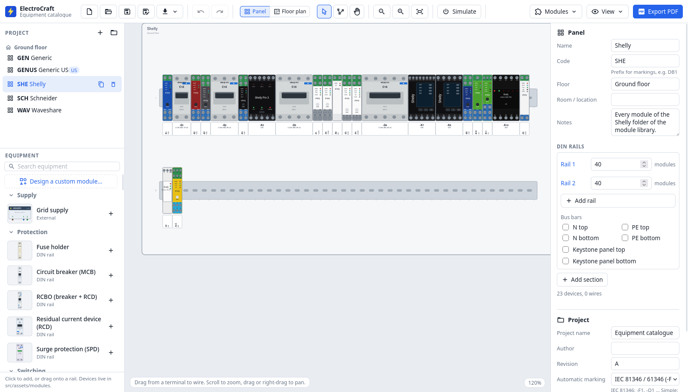

Terminal blocks take **comb bridges**: click between two terminals (or drag across several) to bridge them, just like on the real thing. Breakers, RCDs and isolators take parts from the **Connectors** group of the equipment list: **comb bars** (1 to 4 phases) and **row connectors** (1 to 4 contacts, top to top or bottom to bottom) between two rails, which you drag onto a device (they snap to it) and which also join the neutral poles. You can design your own variations.

### Several enclosures side by side, with N and PE bars

A panel can be made of **sections**: enclosures standing next to each other, each with its **own number of rails and its
own rail lengths**. Wires run between the sections like inside one. Every section can also get **N and PE bus bars along
its top and/or its bottom edge** with one tick each; the enclosure grows to make room, and the bars are wired like any
other device.

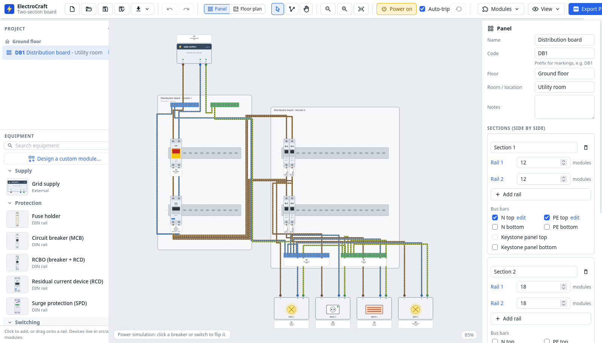

Try it with [multi-section-board.ec](src/assets/examples/multi-section-board.ec).

### Wire it up

Drag from terminal to terminal. Wire colours follow the conductor automatically (L1 brown, L2 black, L3 grey,
neutral blue, earth green/yellow; black/red/blue/white/green in US panels), or pick any colour yourself. Per conductor you
can show, **fade** or hide wires, to see the phases without the neutral and earth clutter. Routing is automatic and tidy; drag a segment or add
bend points to take control.


### See it working

Turn on **Simulate**: live wires glow, animated dashes show the direction and amount of current, pilot lights and loads
light up, and clicking a breaker flips it. Overloads trip breakers and fuses; short circuits are flagged. Works for 1, 2
and 3 phase supplies.


### Plan the whole house on a floor plan

Before the panel, draw the building: load a **picture of your floor plan**, set its scale, and mark every socket, light,
appliance, **network** outlet, **TV / coax** port and **fibre** line. Each outlet is one object with a **count** (a socket of 3 is
drawn as three circles). Connect the outlets with cables **in groups**: power can be chained from outlet to outlet, while network,
coax and fibre ports always get **a cable each**. Bring each group to one of the **electrical or media panels** you placed on the plan
(there can be several) and see the cable lengths. Every circuit that reaches a panel **appears in that panel's planner** (a load for a power circuit, one
cable per outlet for data), ready to be wired to the MCBs, terminal blocks and other modules, and it stays in sync when you change the plan.


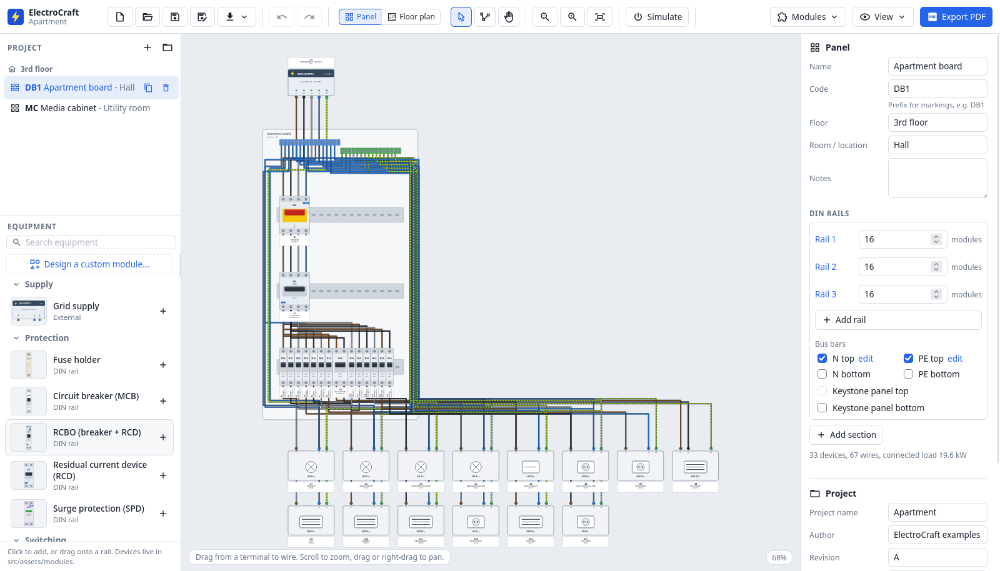

Draw shapes over the picture (rectangles, ellipses, lines and notes, in layers), and fade or hide the picture itself. Select several outlets (Ctrl+click or a box), copy them with Ctrl+C and paste them with Ctrl+V, here or on another floor plan. Speakers and an audio receiver / amplifier are floor plan objects too: speaker cables end at the receiver, which counts its channels.

Every cable can be reshaped by dragging its bends and pulling new nodes out of it, and every kind of outlet, cable and panel (or single object) can be shown, faded or hidden. The panel planner has **keystone patch panels** along the top or bottom of a section (rows and columns of jacks, with the bus bar choices) and wires the network ports of the plan into them.

Outlets and cables live in **layers** (floor, walls, ceiling by default; add, name and remove your own) that can be shown, faded or
hidden like the wires in the panel view.

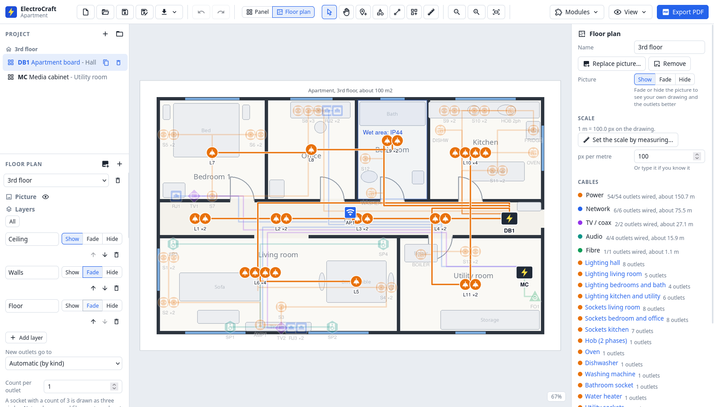

The example **apartment** ([apartment.ec](src/assets/examples/apartment.ec), on the picture [apartment-floorplan.png](docs/examples/apartment-floorplan.png); it is the project the app opens on a first start) has every kind of outlet in a logical place: lights per room, sockets, a two-phase hob, an oven, a dishwasher and a washing machine, network, TV and fibre ports, a Wi-Fi access point, a living room receiver with four speakers, and the circuits wired to a three-phase main board and a media cabinet with a patch panel.


The older [house-floorplan.ec](src/assets/examples/house-floorplan.ec) is a smaller example of the same workflow.

### Organise a whole building

A project holds any number of panels, grouped by **floor and room**. Every device gets an automatic **IEC 81346**
marking (`-F1`, `-Q1`, `-X2`...), or your own text. Projects are saved as small, readable `.ec` files.

### Design your own modules

Missing a device? Open the **module designer**: choose the width, the number of connection rows and columns on the top
and the bottom (they can differ), the current and voltage rating, the connection markings and the colours, and draw the
face with rectangles, circles and text. Give it **several internal switches**, each with a normally-open and/or
normally-closed contact (or both, as a changeover) joining the terminals you choose. Shapes can follow a switch, the trip or
the current state, and a switch can be hidden, so a module can show indicator lights. A shape can also act as a **light**:
it **changes its fill colour** to a second colour while a condition you pick holds (a coil is energised, a contact is closed,
the module is tripped ...). **Inputs** (relay coils) operate the switches when energised,
following, toggling or latching them, so you can build relays, contactors and impulse relays that react in the simulation. Modules are saved inside the project and can be exported to a `.ecm` file and imported into any
other project. A **module library** ships with the app (a fused distribution block, a pushbutton contact block, a changeover selector, a control relay and an impulse relay): they are in the palette of every project, and a copy can be made editable. Manufacturer folders add real products with their true widths and terminals: **Schneider Electric** Easy9 / Resi9 home devices (breakers, RCDs, RCBOs, surge protection, switches, contactors, impulse relays, meters), the **Shelly Pro** series and the **Waveshare** industrial ESP32 controllers (relays, dimmers and energy meters, some of them 19 mm wide). Adding one is just dropping a `.ecm` file into a folder ([how](docs/module-library.md)).

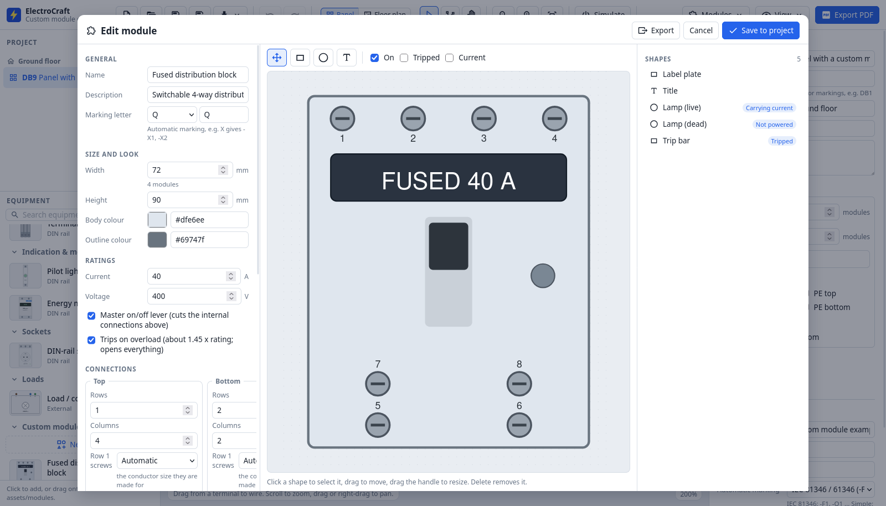


For devices with more to them, the **device designer** has everything the built-in devices have: pole configurations that
set the width and terminals (1P to 3P+N, or a free number of terminals), parameters with options, a simulation role
(protection, switch, meter, bus bar, lamp, load, supply, US breaker ...), DIN, free or US mounting, and SVG artwork with a
live preview. All built-in devices are device modules (`.ecm` files in `src/assets/modules/base`), so any of them can be
copied and changed.

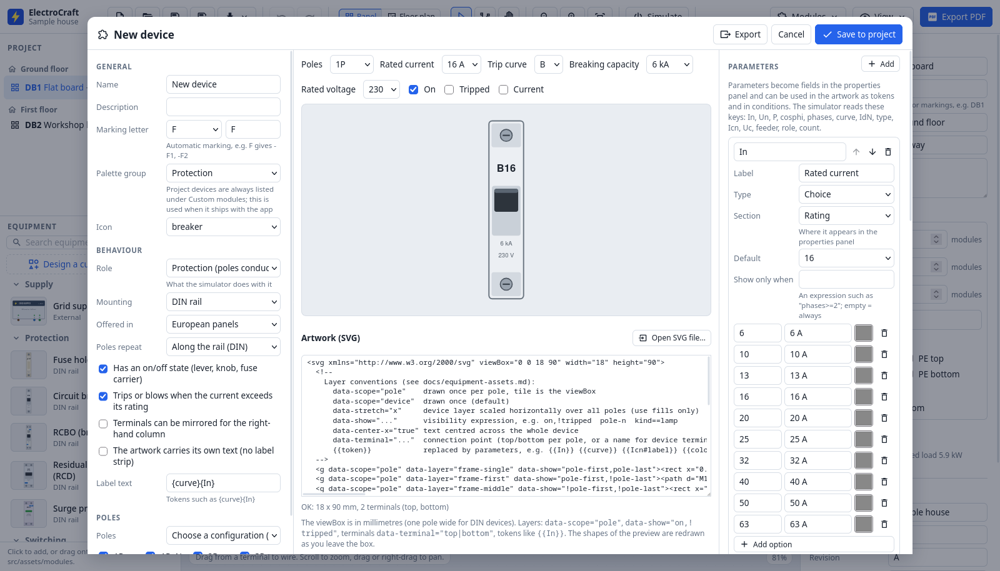

**Clone** any module (pencil, clone and bin buttons in the palette, or *Clone as new module...* on a placed one) to start
a variation from it. How an input actuates its switches (follow, toggle, set, reset) is the module's default, and can be
**overridden per placed device**, so two copies of the same relay can react differently.

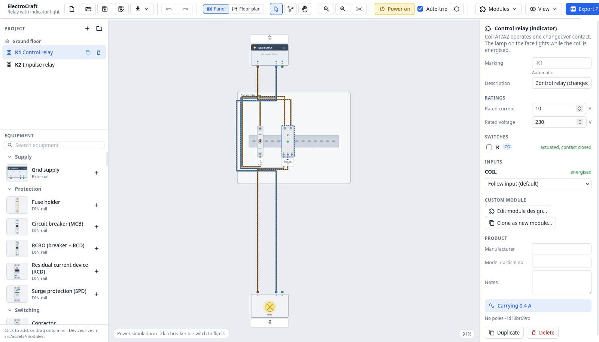

### European and US panels

Add a **DIN-rail panel (EU)** or a **load center (US)** to the same project. US panels have two columns of breaker
spaces on either side of the bus, plug-on 1-, 2- and 3-pole breakers (standard, AFCI, GFCI), a main breaker, neutral and
ground bars, 120/240 V split-phase or 208Y/120 V service, black/red/blue/white/green conductors in AWG sizes, NEC circuit
numbers, and a **panel schedule** in the PDF.

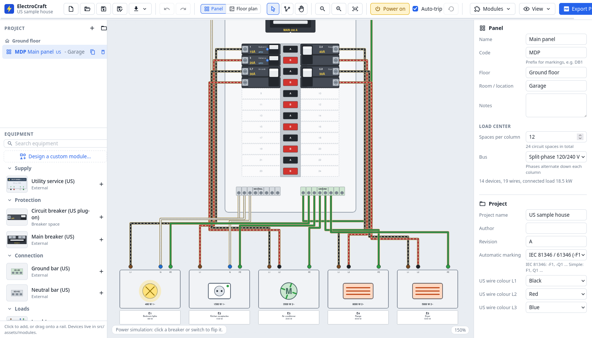

### Works on your phone

On a phone the editor switches to a touch layout: pinch to zoom, drag to pan, tap to select, with the equipment, panels
and properties in slide-up sheets. On a desktop, drag with the right mouse button to move the view.

<p>
  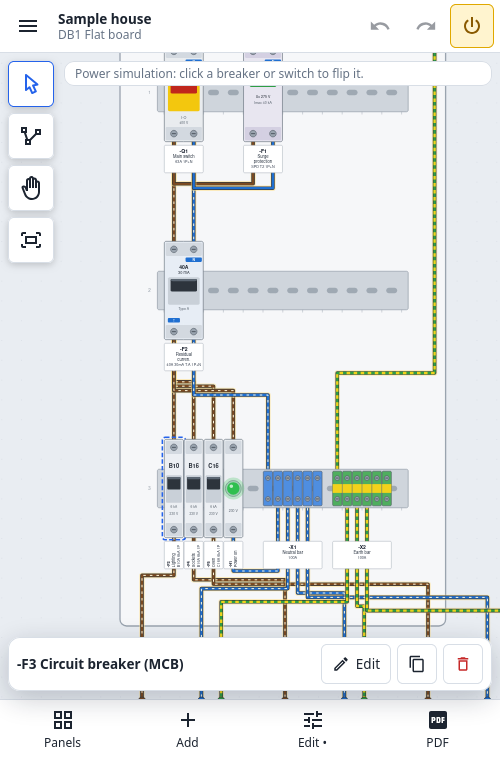
  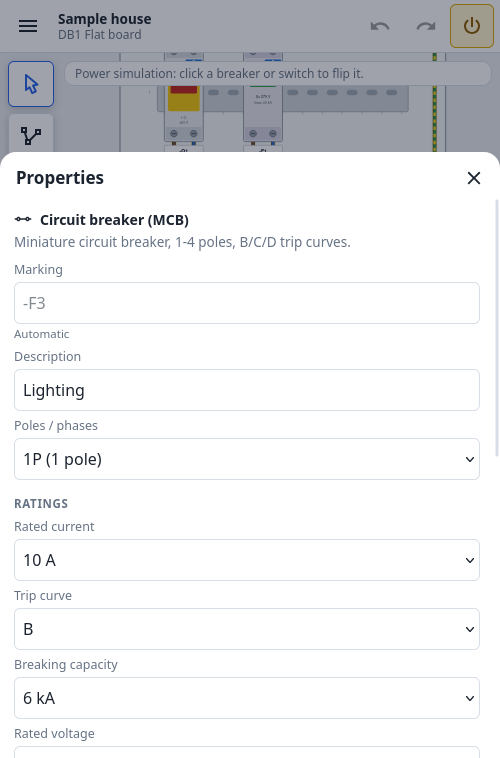
  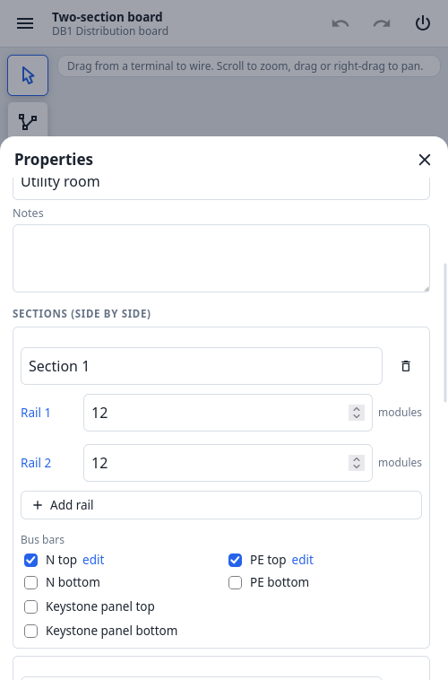
  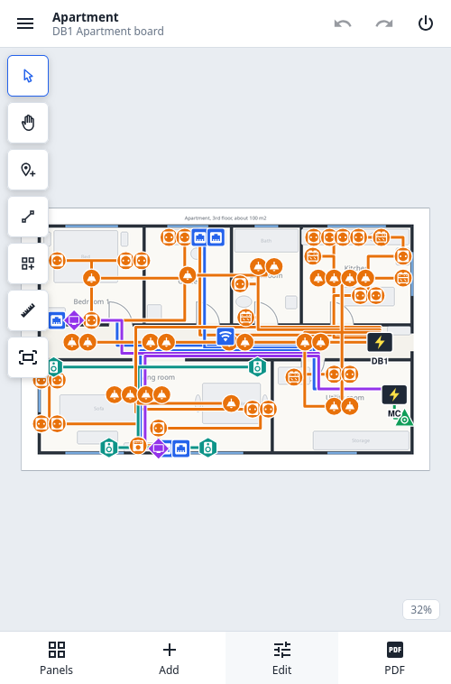
</p>

### Print the documentation

Export one panel, a selection or the whole project to a **vector PDF** with a title block, conductor legend and
equipment list. You choose what appears under each device: markings, descriptions, current, protection data, voltage,
power, manufacturer, model.


## Get started

You need [Node.js](https://nodejs.org/) 20.19 or newer (22 recommended).

```bash
git clone https://github.com/ItsRebaseTime/ElectroCraft.git
cd ElectroCraft
npm install
npm run dev
```

Open **http://localhost:5173**. The app starts with a sample project: a small flat on the ground floor and a 3-phase
workshop upstairs (the toolbar's download menu also has a US house). Press **Simulate** and click the main switch to see the panel go dead.

**Host it as a website:** `npm run build`, then upload the `dist/` folder to any static web host. No server needed.
This repository publishes itself to GitHub Pages on every push to `main` (see `.github/workflows/pages.yml`).

**Desktop app:** a Tauri wrapper is included. See [docs/development.md](docs/development.md#desktop-build).

## A two-minute tour

1. **Add equipment.** Click entries in the palette on the left, or drag them onto a rail. Select a device to change its
   poles and ratings on the right.
2. **Wire it.** Drag from a terminal to another terminal. Click a wire to change its colour or route.
3. **Check it.** Press **Simulate**, flip breakers, watch the warnings.
4. **Label it.** Leave markings automatic or type your own. Use **View** to choose what is shown.
5. **Export it.** **Export PDF**, pick the panels and what to print.
6. **Save it.** `Ctrl+S` writes a `.ec` file. Your work is also kept in the browser in case you close the tab.

The app opens the example **apartment** on a first start; the download button in the toolbar opens the other examples. They are the `.ec` files in [src/assets/examples](src/assets/examples): drop a project there and it is an example too.

## Good to know

* **It is a planning and documentation aid.** The simulation follows connectivity and load currents, but does not model
  RCD earth faults, contactor coils, voltage drop or cable ratings. Always follow the wiring regulations that apply to
  you, and have installations checked by a qualified electrician.
* Everything runs locally in your browser; nothing is uploaded.
* The equipment artwork is generic and original.

## Documentation

| | |
| --- | --- |
| [User guide](docs/user-guide.md) | every feature, shortcuts, troubleshooting |
| [Examples](src/assets/examples) | the example projects that ship with the app (the apartment is the default), and how to add one |
| [Equipment assets](docs/equipment-assets.md) | add or restyle devices: device modules with SVG artwork |
| [Module library](docs/module-library.md) | ship custom modules with the app as `.ecm` files |
| [Simulation model](docs/simulation.md) | what is computed and what is not |
| [Project file format](docs/project-file-format.md) | the `.ec` format |
| [Architecture](docs/architecture.md), [Development](docs/development.md) | for contributors |

## License

ElectroCraft is free software under the **GNU Affero General Public License v3.0 or later** (`AGPL-3.0-or-later`),
see [LICENSE](LICENSE). If you run a modified version as a network service, the AGPL asks you to offer your users the
source of your version. Your own projects and exported PDFs belong to you.

Copyright (C) 2026 the ElectroCraft authors.

Third-party material: icons from [Material Design Icons](https://pictogrammers.com/library/mdi/) (Apache-2.0), the
Liberation Sans font (SIL OFL 1.1, [licence](public/fonts/LICENSE-Liberation.txt)), and permissively licensed npm
packages (React, zustand, jsPDF, svg2pdf.js, Vite, Tauri and others).
