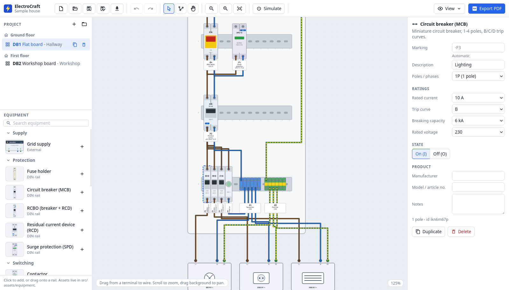
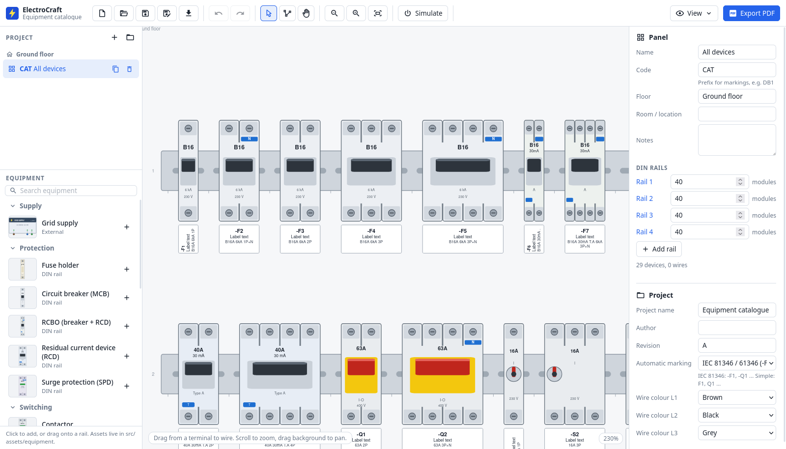
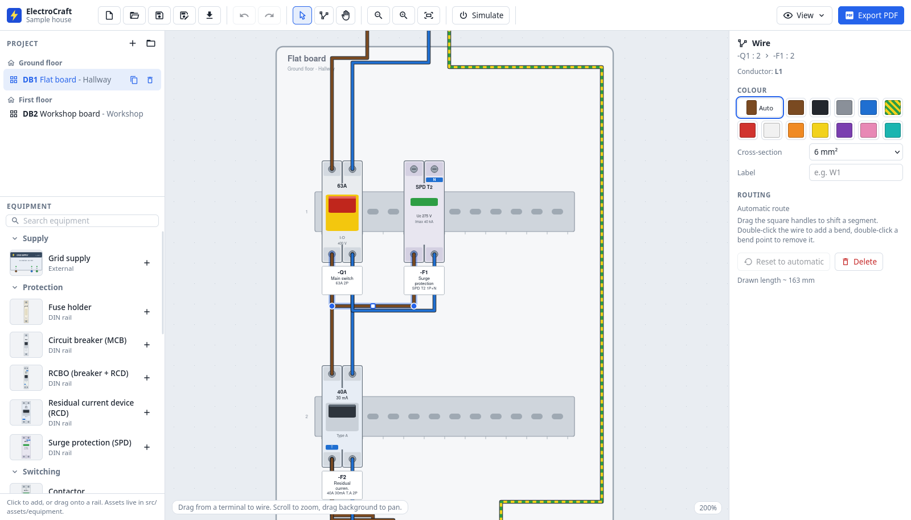
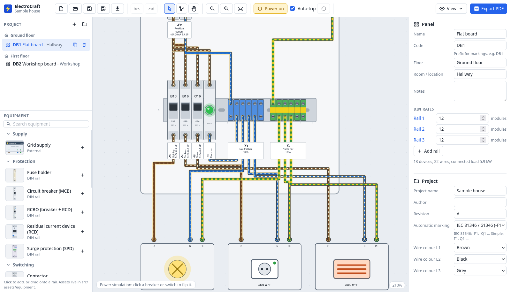
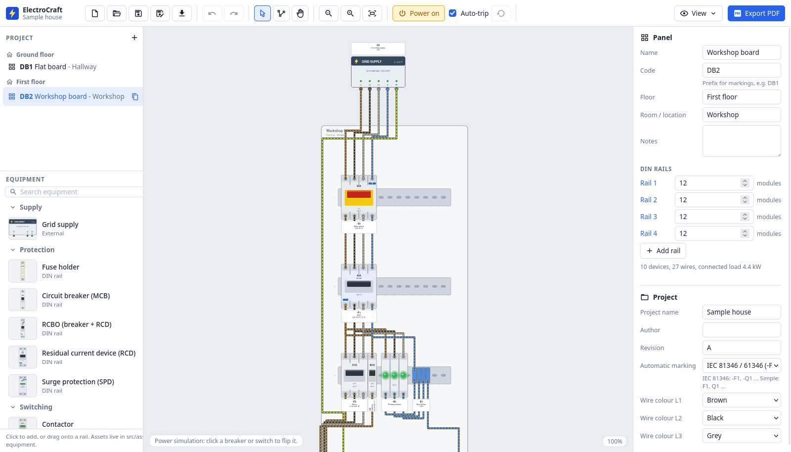
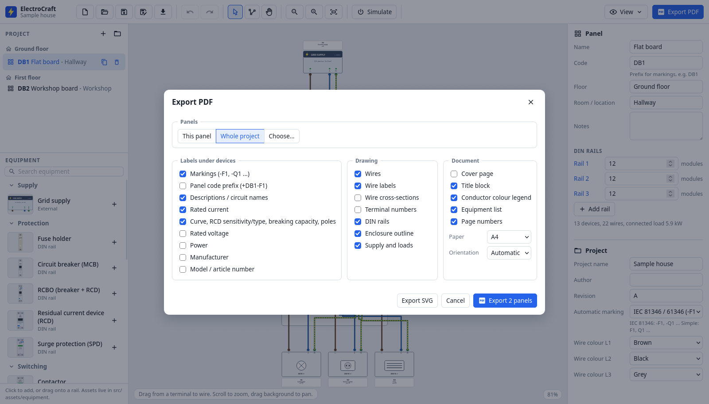
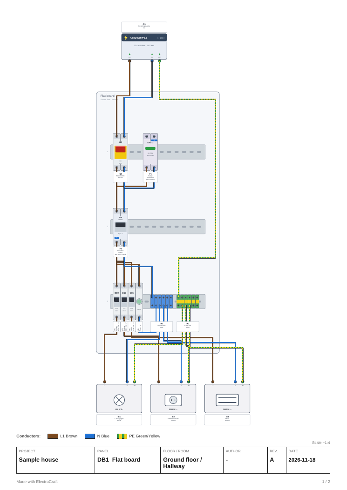

# ElectroCraft

**Plan your electrical panel, wire it, see it work, and print the documentation.**

ElectroCraft is a free planner for European electrical distribution boards. Drag circuit breakers, RCDs, terminal
blocks and other DIN-rail equipment onto rails, connect them with colour-coded wires, switch on a live simulation to
watch current flow, and export a clean PDF with markings and ratings. It runs in your browser or as a desktop app.

**[Try it in your browser](https://itsrebasetime.github.io/ElectroCraft/)** (no install, everything stays on your computer)



## What you can do

### Lay out the board

Place equipment on DIN rails; it snaps to the module grid and never overlaps. Choose poles and phases (1P, 1P+N, 2P, 3P,
3P+N) and set ratings: current, trip curve, RCD sensitivity and type, voltage, load power. Every device is a plain SVG
file, so you can restyle or add your own.



Terminal blocks take **comb bridges**: click between two terminals to bridge them, just like on the real thing.

### Wire it up

Drag from terminal to terminal. Wire colours follow the conductor automatically (L1 brown, L2 black, L3 grey,
neutral blue, earth green/yellow), or pick any colour yourself. Routing is automatic and tidy; drag a segment or add
bend points to take control.



### See it working

Turn on **Simulate**: live wires glow, animated dashes show the direction and amount of current, pilot lights and loads
light up, and clicking a breaker flips it. Overloads trip breakers and fuses; short circuits are flagged. Works for 1, 2
and 3 phase supplies.





### Organise a whole building

A project holds any number of panels, grouped by **floor and room**. Every device gets an automatic **IEC 81346**
marking (`-F1`, `-Q1`, `-X2`...), or your own text. Projects are saved as small, readable `.ec` files.

### Print the documentation

Export one panel, a selection or the whole project to a **vector PDF** with a title block, conductor legend and
equipment list. You choose what appears under each device: markings, descriptions, current, protection data, voltage,
power, manufacturer, model.





## Get started

You need [Node.js](https://nodejs.org/) 20.19 or newer (22 recommended).

```bash
git clone https://github.com/ItsRebaseTime/ElectroCraft.git
cd ElectroCraft
npm install
npm run dev
```

Open **http://localhost:5173**. The app starts with a sample project: a small flat on the ground floor and a 3-phase
workshop upstairs. Press **Simulate** and click the main switch to see the panel go dead.

**Host it as a website:** `npm run build`, then upload the `dist/` folder to any static web host. No server needed.
This repository publishes itself to GitHub Pages on every push to `main` (see `.github/workflows/pages.yml`).

**Desktop app:** a Tauri wrapper is included. See [docs/development.md](docs/development.md#desktop-build).

## A two-minute tour

1. **Add equipment.** Click entries in the palette on the left, or drag them onto a rail. Select a device to change its
   poles and ratings on the right.
2. **Wire it.** Drag from a terminal to another terminal. Click a wire to change its colour or route.
3. **Check it.** Press **Simulate**, flip breakers, watch the warnings.
4. **Label it.** Leave markings automatic or type your own. Use **View** to choose what is shown.
5. **Export it.** **Export PDF**, pick the panels and what to print.
6. **Save it.** `Ctrl+S` writes a `.ec` file. Your work is also kept in the browser in case you close the tab.

Open the files in [docs/examples](docs/examples) to see more.

## Good to know

* **It is a planning and documentation aid.** The simulation follows connectivity and load currents, but does not model
  RCD earth faults, contactor coils, voltage drop or cable ratings. Always follow the wiring regulations that apply to
  you, and have installations checked by a qualified electrician.
* Everything runs locally in your browser; nothing is uploaded.
* The equipment artwork is generic and original.

## Documentation

| | |
| --- | --- |
| [User guide](docs/user-guide.md) | every feature, shortcuts, troubleshooting |
| [Examples](docs/examples) | sample project and an equipment catalogue to open |
| [Equipment assets](docs/equipment-assets.md) | add or restyle devices with SVG + JSON |
| [Simulation model](docs/simulation.md) | what is computed and what is not |
| [Project file format](docs/project-file-format.md) | the `.ec` format |
| [Architecture](docs/architecture.md), [Development](docs/development.md) | for contributors |

## License

ElectroCraft is free software under the **GNU Affero General Public License v3.0 or later** (`AGPL-3.0-or-later`),
see [LICENSE](LICENSE). If you run a modified version as a network service, the AGPL asks you to offer your users the
source of your version. Your own projects and exported PDFs belong to you.

Copyright (C) 2026 the ElectroCraft authors.

Third-party material: icons from [Material Design Icons](https://pictogrammers.com/library/mdi/) (Apache-2.0), the
Liberation Sans font (SIL OFL 1.1, [licence](public/fonts/LICENSE-Liberation.txt)), and permissively licensed npm
packages (React, zustand, jsPDF, svg2pdf.js, Vite, Tauri and others).
