# User guide

This guide covers everything ElectroCraft can do. If you just want to try it, the
[README](../README.md) has a two-minute tour.

## The screen

| Area | What it does |
| --- | --- |
| **Top toolbar** | New / open / save, undo / redo, tools, zoom, **Simulate**, **View** options, **Export PDF** |
| **Left, top: Project** | Your floors and panels. Click a panel to open it. |
| **Left, bottom: Equipment** | Everything you can place. Search, click to add, or drag onto a rail. |
| **Centre** | The panel: enclosure, DIN rails, devices, wires |
| **Right** | Properties of whatever is selected (device, wire, rail), or of the panel and project when nothing is |

## Projects, floors and panels

A project holds any number of panels. Each panel has a **name**, a **code** (such as `DB1`, used as a marking prefix),
a **floor** and a **room**. The Project tree groups panels by floor.

* **+** next to *Project* adds a panel on the current floor; the folder button adds one on a new floor.
* Hover a panel to **duplicate** or **delete** it.
* Rename a panel, change its floor or room, or edit the DIN rails in the properties panel (click empty canvas to see it).
* **Rails:** each panel starts with two 12-module rails. Add more, change their length, or reorder them there.
  A rail cannot be shortened below the devices on it.
* **Sections:** *Add section* puts a second enclosure to the right of the first, with its own rails. Every section
  has its own number of rails and its own rail lengths, and the enclosure is as wide as its longest rail. Select a rail
  to move it to another section, or reorder it inside its section. A section can only be deleted while it holds no devices.
* **Bus bars:** each section offers *N top*, *PE top*, *N bottom* and *PE bottom*. A ticked bar is a real bus bar
  along that edge of the enclosure (N at the left, PE at the right); the enclosure grows to make room. Wire to it like
  to any other device, and use *edit* beside the checkbox to change its number of terminals. Unticking removes the bar
  and its wires.
* **Keystone patch panels:** *Keystone panel top* and *Keystone panel bottom* (below the bus bar choices) add a **patch panel**
  along that edge of the section: a grid of keystone jacks whose size you set with **rows** (1 to 4) and **columns** (1 to 24)
  right in the section settings. Every jack is a terminal of its own (jacks are never joined), numbered 1, 2, 3 ... row by row.
  It sits next to the bus bars of the same edge (neutral bar, patch panel, earth bar from left to right) and the enclosure
  grows, and widens, to fit it. Reduce the size and the wires to jacks that disappear are removed. The cables that come from the
  floor plan (see *Floor plans*) are items of the panel; **select the patch panel** (*edit*) and press **Wire floor plan cables
  to free jacks** to wire every cable that has no wire yet to the next free jack, in reading order, coloured by what it carries
  (network blue, coax violet, fibre orange). Or draw the wires yourself.

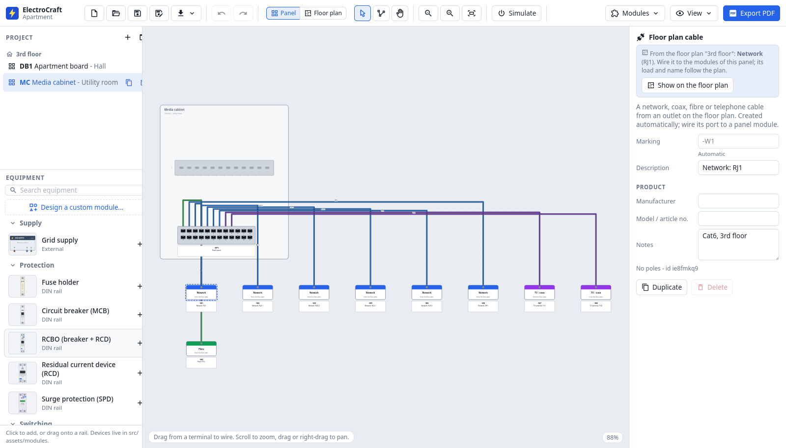

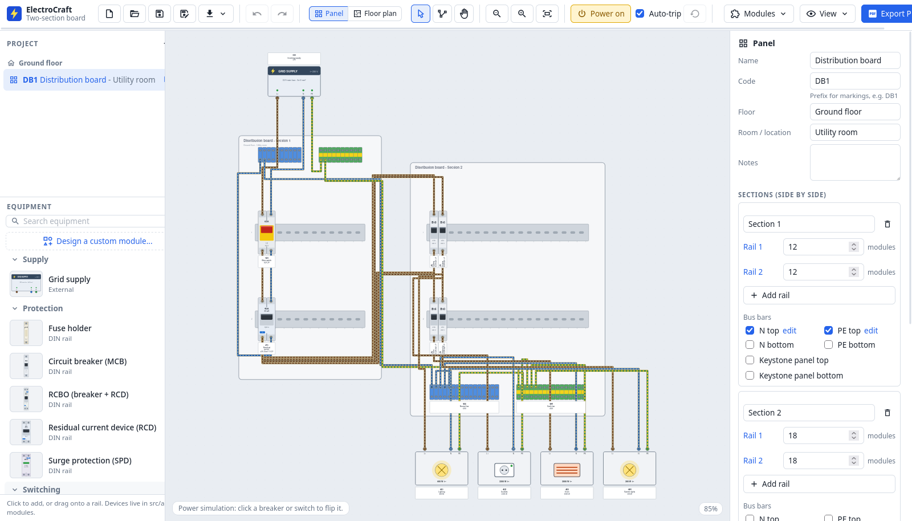

  The example [examples/multi-section-board.ec](../src/assets/examples/multi-section-board.ec) shows a two-section board: a main switch and
  RCD with N and PE bars along the top of the first section, and sixteen-module rails with bars along the bottom of the second.
  Adding or removing bars, rails or sections moves the supply and loads outside the enclosure out of the way.

## Floor plans

The **Floor plan** workspace (the *Panel / Floor plan* switch in the toolbar, or *Floor plan* in the phone menu) is where you
plan the whole building before you plan a panel. Load a picture of a floor plan, mark every outlet, connect them with cables
in groups, and bring the groups to the panels. Everything you connect appears in the panel planner, ready to be wired to the
modules of the panel.

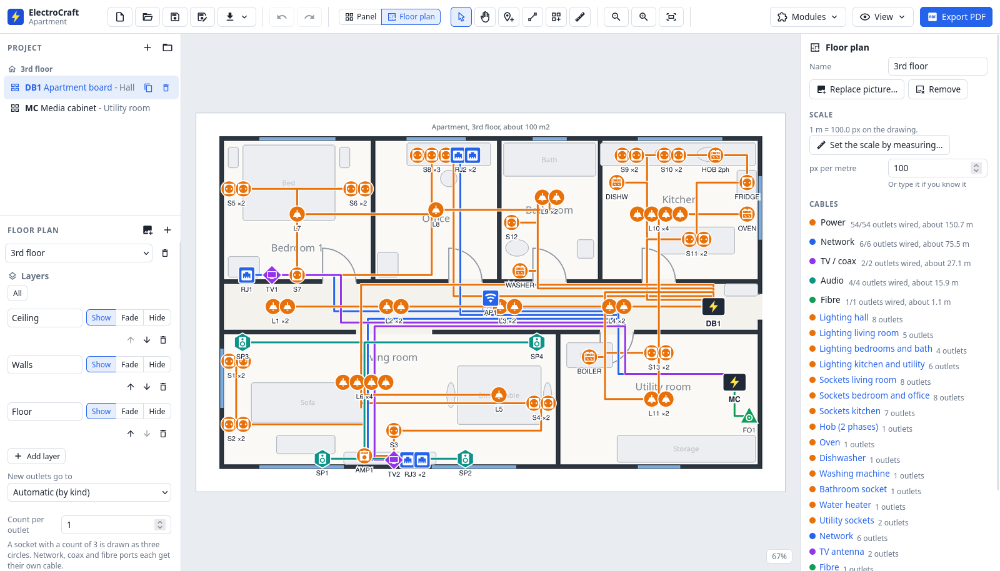

The pictures in this chapter show the example [apartment.ec](../src/assets/examples/apartment.ec): open it, or start from your own plan.

**1. Add a floor plan.** The picture button next to *Floor plan* on the left loads a PNG, JPEG or WebP picture (it is scaled
down to fit in the project file); the plus button adds an empty sheet. A project can hold any number of floor plans, for
example one per floor. In the properties you can replace or remove the picture and rename the plan.

**2. Set the scale.** With the ruler tool, click both ends of something whose length you know (a wall, a door), then type the
real distance. From then on every cable shows its length. You can also type the pixels per metre.

**3. Mark the outlets.** Pick a kind of outlet on the left and click the plan to place it; click again to place more.
The kinds are grouped by what they carry: **power** (socket, double socket, light, light switch, fixed appliance),
**network** (RJ45 outlet, Wi-Fi access point, camera), **TV / coax**, **audio** (speaker), **fibre**, **telephone** and **other**. The
**audio receiver / amplifier** is a power outlet too (it has a load, and can be part of a power circuit) that speaker cables end at. Each is drawn with a **pictogram** of what it is (a socket, a ceiling light, a switch, an Ethernet jack, a Wi-Fi
symbol, a camera, a TV, a fibre ...) on a shape and colour that tell the kind of cable (circle: power, square: network, diamond: coax,
triangle: fibre, rounded: telephone and other), and gets a label (`S1`, `RJ3`, `TV2` ...) that you can change. Drag an outlet to move it, **Delete** removes it.

**Selecting several, copy and paste.** **Ctrl+click** (or Shift+click) adds an outlet to the selection or takes it out again, **Ctrl+drag**
on empty space selects the outlets in a box, and **Ctrl+A** selects all the visible ones. Drag any selected outlet to move them
all, **Delete** removes them, and the properties panel offers a layer for all of them. **Ctrl+C** copies the selection and
**Ctrl+V** pastes copies, centred on the pointer when it is over the plan (otherwise shifted a little more with every paste), with
fresh labels and the same kind, count, load, layer and note. The copies are selected, so you can drag them into place straight
away, and you can paste on another floor plan too (a layer the other plan does not have falls back to the usual one for the kind).
Cables are not copied: connect the copies with the cable tool. When nothing is selected the plan's properties have a *Paste* button.

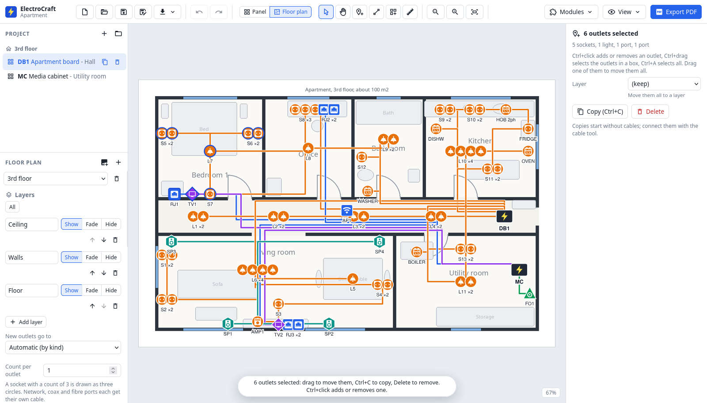

Every kind of outlet is a **single object with a count**: there is one *Socket*, and you say how many sockets are at that place
(1 to 12). Set *Count per outlet* on the left before placing, or change the *Count* of a placed outlet in its properties. The
count is drawn as that many symbols side by side (`S3 ×3` is three circles), and works the same for lights, switches, network
ports, TV ports and fibre ports. Power outlets have a connected load in watts **per socket / light** (a default per kind,
editable); the place's load is that times the count.

**Layers.** Objects live in **layers**, so you can plan the walls, the floor and the ceiling separately. A new floor plan starts with
*Floor*, *Walls* and *Ceiling*; under *Layers* on the left you can rename them, add more (*Add layer*), reorder them (the top of the
list is drawn on top) and delete them (their outlets and cables move to the layer below). Every layer has **Show / Fade / Hide**,
like the wire visibility of the panel view (the same controls are in the *View* menu while the floor plan is open): hidden layers
are not drawn and cannot be clicked, faded ones are drawn light. *New outlets go to* chooses the layer for what you place next;
*Automatic* uses the usual layer of each kind (lights, Wi-Fi access points and cameras on the ceiling, sockets, switches and data
ports on the walls, fixed appliances on the floor). Change the layer of an outlet or a cable in its properties; a cable starts on the
layer of its first outlet. Layer visibility is a view setting and is not saved with the project; the layers and what is on them are.

**Visibility of the objects.** Besides the layers, every kind of object has its own Show / Fade / Hide: the **picture**, all the **shapes**, each **kind of outlet** (the
eye button on its row in the list on the left steps through shown, faded and hidden), each **kind of cable**, the **panels**, and
every **single outlet, cable or panel** (*On the plan* in its properties). The *View* menu lists all of them (layers, outlets,
cables, panels) with *Show everything*. An object is shown as hidden as the most hidden of its layer, its kind and itself. Hidden
objects are not drawn and cannot be clicked; the objects you hid one by one are listed in the plan's properties with a *Show*
button. Like the layers this is a view setting and is not saved.

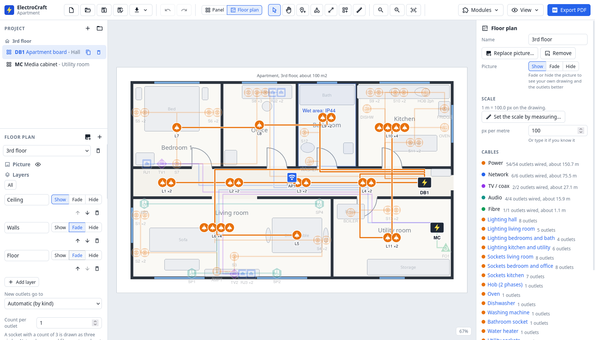

**Shapes.** The shape tool (or *Shapes* in the list on the left) draws **rectangles, ellipses, lines and text** on the plan, for walls the
picture does not show, rooms and areas to mark, cable routes and notes. Pick a shape and **drag on the plan** to draw it (a click gives it the
usual size; a line that is nearly level or upright snaps to level or upright); a text is placed with a click and typed in the properties.
Select a shape to **move** it (drag, or several with Ctrl+click), **resize** it with the square handles at its corners or the ends of a line,
and set its outline colour and width, its fill colour and opacity (or no fill), its exact position and size (with the length in metres once the
scale is set), its **layer** and its visibility in the properties. **Ctrl+C / Ctrl+V** copy and paste shapes like outlets, **Delete** removes them.
Shapes are drawn above the picture and below the cables and outlets, in layer order. They are part of the project, but not of the panels.

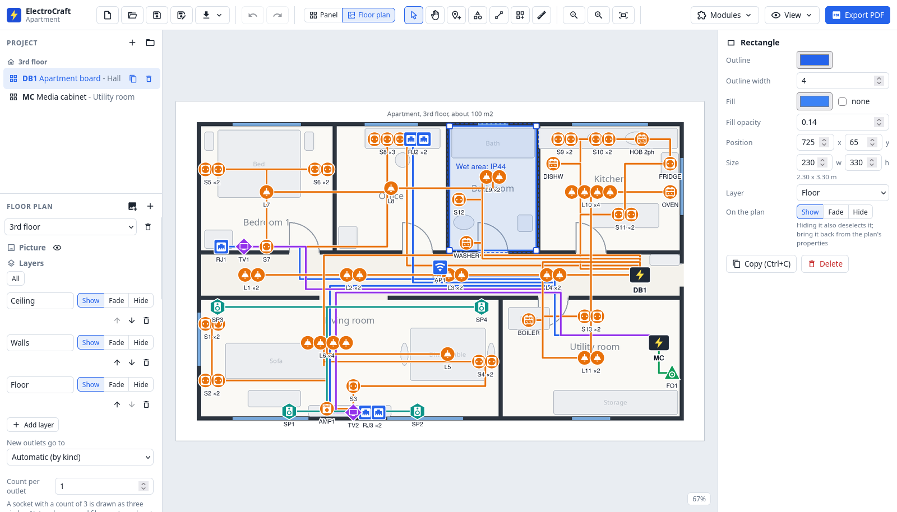

**The picture** has its own Show / Fade / Hide: the eye button next to *Picture* in the list on the left, *Picture* in the plan's properties, and
the *View* menu. Fade it to see your own drawing, the outlets and the cables better, or hide it to work on a blank sheet; the scale and everything
you drew stay where they are.

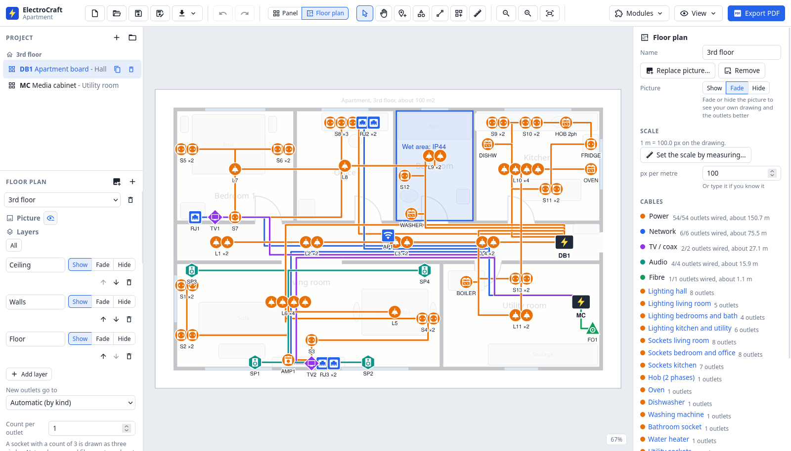

**4. Place the panels.** Every panel of the project (electrical or media cabinet) can be placed on a plan, and **a plan can
have as many panels as you like**: a main board, sub-boards, a media cabinet. Click a panel in the list on the left, then click
the plan; the plus button next to *Panels* adds a new panel to the project and lets you place it right away. Its marker can be
moved like an outlet, and a panel can be on several plans (one per floor it serves). Each circuit ends at one panel, chosen by
clicking its marker or in the circuit's properties, and appears only in that panel.

**5. Connect the outlets in groups.** With the cable tool, click an outlet to start a **circuit**, click the next outlets to
add them, click empty space to put a bend in the cable, and finish by clicking a panel. An outlet that already has a circuit
continues that circuit when you click it. A circuit carries one kind of cable only (the app tells you when you mix them) and
has a name, a cable type (for power `3x1.5 mm²` to `5x10 mm²`, for data Cat5e to Cat7, RG6, OS2 ...), a colour and a panel.
How it is wired decides what appears in the panel:

* **Chain** (the default for power): one cable runs from outlet to outlet in order and then to the panel, like the sockets of one
  circuit. You can reorder the outlets in the properties. The cable from the panel arrives at the **outlet you clicked last**
  before clicking the panel (click an outlet of an existing circuit, then the panel, to connect at that outlet); the chain continues
  from there, in both directions if it is in the middle. *Connected at* in the circuit's properties changes it later. A power circuit has a phase count and a connected load, the sum of its
  outlets (load times count) unless you set it by hand. A power circuit can also be a star, with a cable from every outlet.
* **Star** (always for network, coax, fibre and telephone): **every port has its own cable** to the panel. These cannot be
  chained like AC power, so the app does not offer it; an outlet with a count of 2 brings two cables, and the cable count and
  length of the circuit include all of them.

**Phases.** Sockets and appliances have a **Phases** setting (1, 2 or 3): a hob can be single-phase, two-phase or three-phase, and a
three-phase socket is a socket with three. A power circuit takes the **most phases of its outlets** (the *Phases* of the circuit offers
*Automatic* or 1, 2 or 3 to override it), and that is the number of phases of the load that appears in the panel, so the load has
the terminals L1, L2, L3 you need to wire it. Outlets in a star circuit each give their own load with their own phases. The plan shows
`2ph` or `3ph` next to the label of such an outlet.

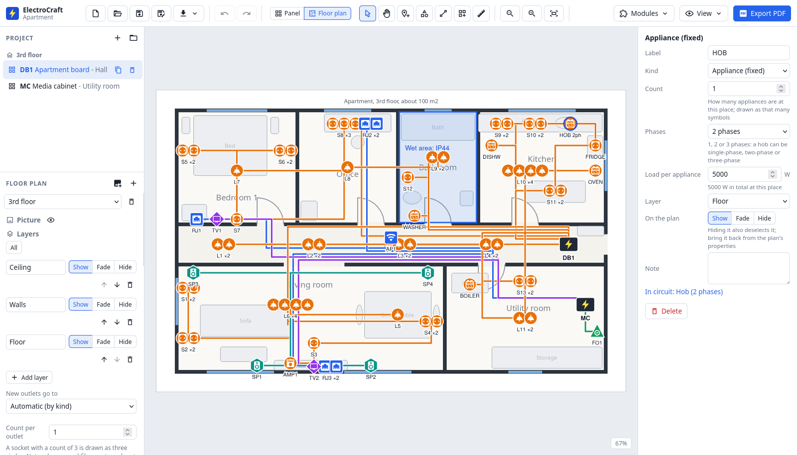

**Speakers and the receiver.** A *speaker* has a count like any outlet (a stereo pair at one place is a count of 2) and every speaker has its
own cable, as for network and fibre. Draw a speaker circuit with the cable tool and finish it by **clicking the audio receiver**: the
cables then end at the receiver instead of a panel (*Ends at* in the circuit's properties also offers the panels, for a speaker
distribution panel). The receiver has a number of **speaker channels** (2 to 16) and its properties show how many the connected
speakers use. A speaker circuit that ends at a receiver puts nothing in the panels.

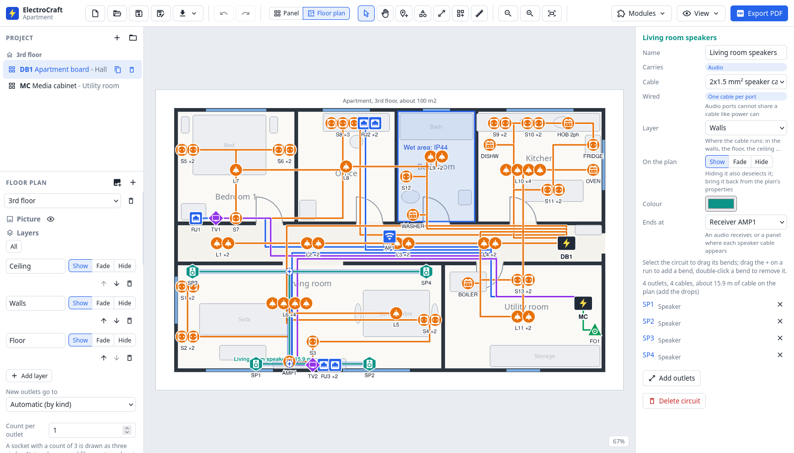

Cables are drawn and measured along the walls (horizontally, then vertically; extra bends steer them), so lengths are realistic.
**Select a circuit** (click its cable, or its name in the plan's properties) to edit its route: every run shows a **+**; **drag the +**
to pull a new bend (a node) out of the cable and drop it where the cable should go, **drag a bend** (the round handles) to move it,
**double-click a bend** to remove it, and *Straighten* in the circuit's properties removes them all. This works for the cable between
the outlets of a chain, for the run to the panel, and for each outlet's own cable in a star.
They show the plan length only: add the drops to the outlets and the panel yourself. The summary in the properties of the plan
lists, per kind of cable, how many outlets are wired and the total length.

**6. Route them to the panel modules.** As soon as a circuit ends at a panel, that panel gets an item for it, below the
enclosure, named after the circuit:

* a **power circuit** becomes a **load** with the circuit's name, phases and connected load (and the cable and length in its
  notes), so you wire an MCB to it like to any load, and the simulation sees the current;
* a **network, coax, fibre or telephone circuit** becomes one **cable** item **per port** (an outlet `RJ3` with a count of 2 gives
  `Network: RJ3.1` and `Network: RJ3.2`) with a single port that you wire to a module of the panel, such as a terminal block you
  use as a patch field.

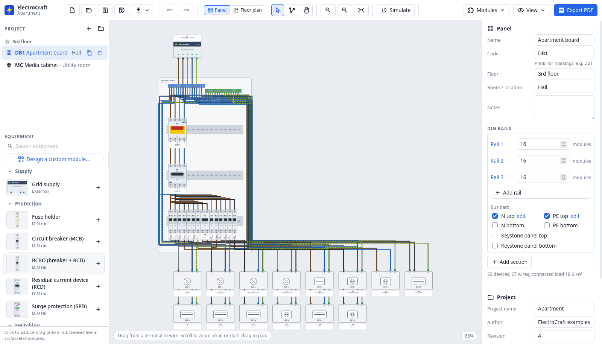

The items follow the plan: renaming a circuit, changing its load or count, or moving an outlet into or out of it updates the
items (a lower count removes the extra port cables), and the wires you drew stay. If the circuit no longer ends at that panel (or is deleted, or its panel marker is removed), the item
and its wires are removed. Because of that these items cannot be deleted or duplicated in the panel planner; their properties
say where they come from and have a *Show on the floor plan* button. Undo and redo treat the plan and the panels together.

Notes: a circuit stays on one floor plan, so a cable between floors is two circuits (one per floor) joined in a panel. The
floor plans are not part of the PDF export yet. On a phone the tools are in the column on the left, the kinds of outlet open
from *Add*, and the properties from *Edit*; names and labels appear when you zoom in.

## Placing equipment

* **Ctrl+C** copies the selected devices (with their settings, without their wires) and **Ctrl+V** pastes them: a device goes to the
  free place on a rail closest to the mouse pointer; several copied devices keep their distances (modules apart, rails below).
* **Click** an entry in the palette to place it on the first free spot (on the selected rail, if you selected one).
  Or **drag** it onto a rail.
* Devices **snap to half-module positions** and never overlap. If a rail is full you get a message instead.
* **Move** by dragging. Arrow keys nudge by half a module. Hold **Shift** to select several devices.
* **Duplicate** with `Ctrl+D`, **delete** with `Delete`.
* The supply and loads are *external* items; they can be placed anywhere outside the enclosure.

### Poles, phases and ratings

Select a device to change it in the properties panel:

* **Poles / phases**: 1P, 1P+N, 2P, 3P, 3P+N (what is offered depends on the device). A bigger device needs more room
  on the rail; if it does not fit, the change is refused. Wires to poles that no longer exist are removed.
* **Ratings** where they make sense: rated current, trip curve (B/C/D/K/Z), breaking capacity, RCD sensitivity and type,
  voltage, load power, power factor.
* **Supply:** choose 1, 2 or 3 phases and the main fuse; the matching terminals appear.
* **Loads:** lighting, heater, motor, socket circuit or generic, 1 or 3 phase, with power and power factor.
* **State:** breakers, switches, fuse holders and the supply can be on or off. Off devices show their lever or carrier
  in the open position.
* **Product info:** manufacturer, model / article number and notes. These can appear on the label strips and in the
  equipment list of the PDF.

### Terminal blocks and comb bridges

Select a terminal block. Between each pair of neighbouring terminals a dashed slot appears: click it to insert a
**comb bridge**, click a bar to remove it. The properties panel has checkboxes per gap plus *Bridge all* /
*Remove all*. Bridged terminals are one conductor in the simulation. To bridge several terminals at once,
**press on a slot and drag** across the terminals: the comb gets as long as the drag (drag back to shorten it).

### Connectors: comb bars and row connectors

The **Connectors** group at the end of the equipment list holds the parts that join breakers, RCDs and isolators (`mcb`,
`rcbo`, `rcd`, `isolator`) on a DIN rail: **comb bars** and **row connectors**.

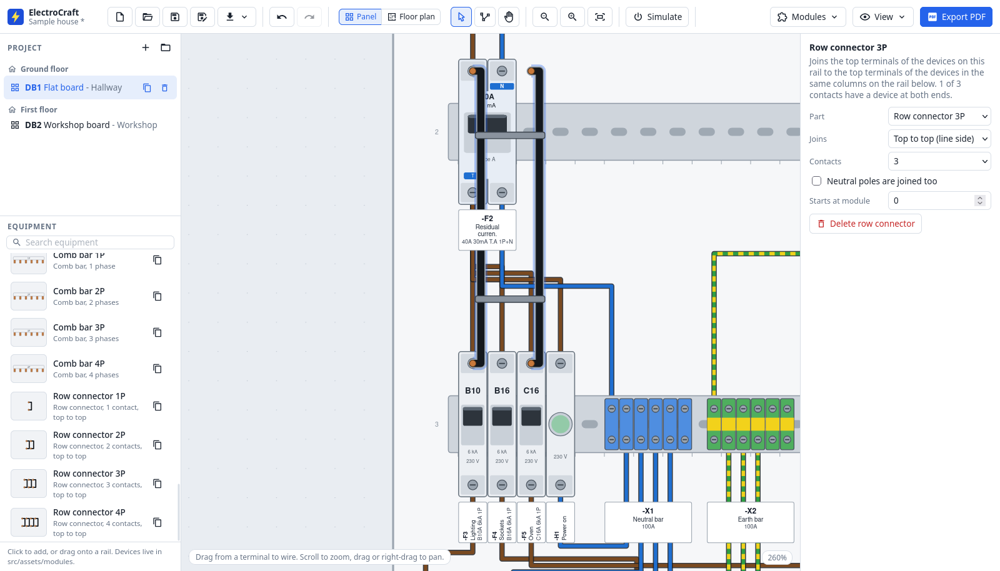

* **Comb bar 1P to 4P** is the busbar with a pin per module, plugged into the terminals of devices standing next to each
  other. With 1P all the pins are one conductor; with 2P, 3P or 4P the pins take turns (L1, L2, L3, L1 ...), so one comb feeds a
  row of single pole breakers from three phases. The neutral pole of a 1P+N device gets no pin.
* **Row connector 1P to 4P** joins two rails: it takes the **top terminals** (or the **bottom terminals**) of the devices on one
  rail to the same terminals of the devices **in the same columns** on the rail below, one contact per module. Top to top carries
  the supply of one row on to the next, bottom to bottom joins the outgoing side. Where a column has a device on only one of
  the rails, no contact is made.

To use a part, **drag it from the list onto a device**: while you drag, the supported device nearest to the pointer is highlighted
and the part **snaps** to it when you drop (a comb bar starts there and is as long as the part says, 6 modules for the built-in
ones; a row connector starts there). You can also **select the devices on one rail** (Shift+click) and click the part: a comb
bar goes across the selection, a row connector starts at the first selected device. With nothing selected, clicking a part
waits for a click on a device. Esc cancels.

**Neutral.** The neutral poles of 1P+N and 3P+N devices take a pin too: all the neutral pins of a comb bar are one conductor
(the phases of the line pins take turns over the line poles only), and a row connector joins neutral to neutral in the same
column, drawn in blue. Switch *Neutral poles* off in the properties of a placed part, or in the designer, for a part that
joins the line poles only.

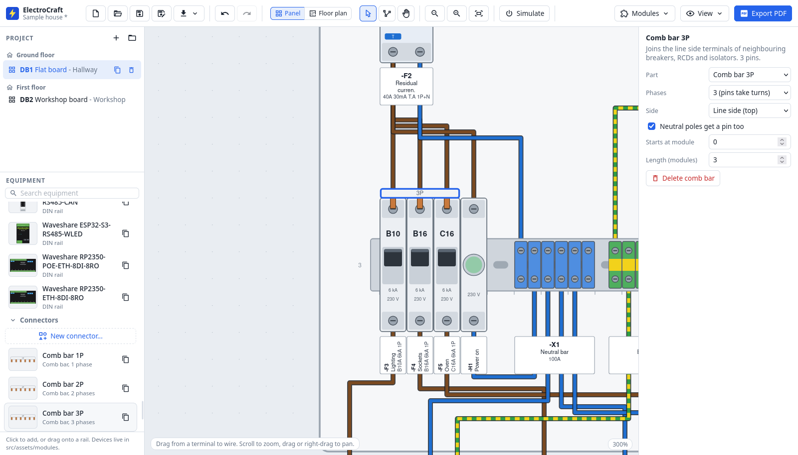

A row connector is drawn as thick insulated conductors, held together by two grey **brackets** when it has two or more contacts (the
brackets show that they are one part: they are not wires and carry nothing). A row connector is drawn in every column it covers, also where no device stands yet, and, like a wire, lies **below the devices until
you select it**. Only one arrangement fits physically when row connectors hang on the same module: **module / top-to-top connector / module /
bottom-to-bottom connector / module**. Anything else (two top-to-top ones in a row, a bottom-to-bottom above a top-to-top, ...) is refused,
and two row connectors cannot cover the same columns between the same two rails. When you place a row connector below a module that already has a top-to-top one, it is placed **bottom to bottom by itself** (and top to top above a bottom-to-bottom one).

Click a placed bar or connector to change its part, phases or contacts, side, start and length, or to delete it. Joined
terminals are one conductor in the simulation.

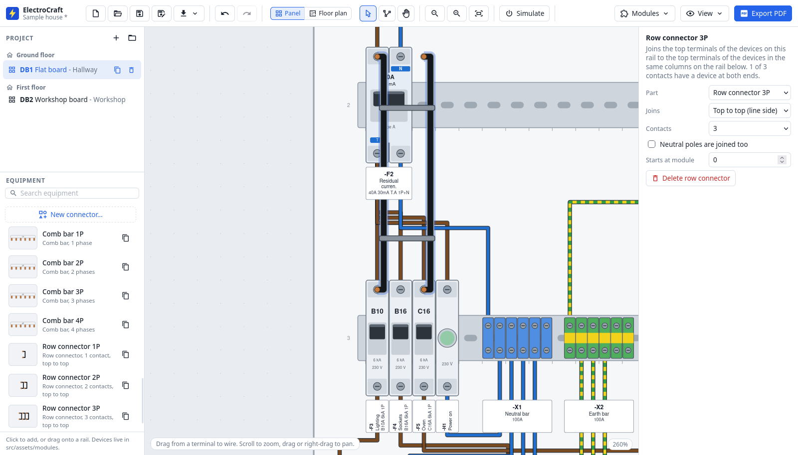

**Your own variations.** The copy button of a part (or **New connector...**) opens the connector designer: name,
description, kind (comb bar or row connector), phases or contacts, the length of a new comb bar, the side of a row
connector, whether it joins the neutral poles, and the colours of the body and the pins. Saved parts are stored in the project, listed with edit, copy and delete
buttons, and can be picked for any placed bar or connector in its properties. Deleting a part leaves the bars made from it in
place, drawn as the built-in part.

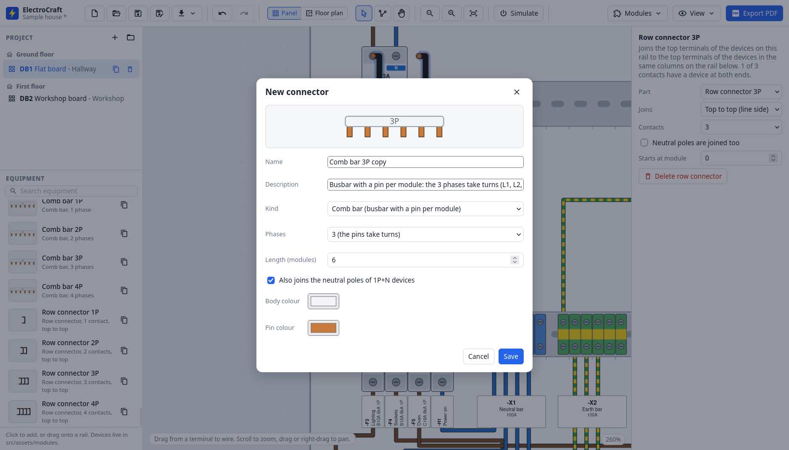

## Wiring

**Drag from one terminal to another** to connect them. Terminals highlight when you hover them. Any number of wires
can share a terminal. Wiring the same two terminals twice is refused.

For wires with hand-placed bends, switch to the **wire tool** (`W`): click a terminal, click empty space for each bend
(bends snap to horizontal/vertical), then click the target terminal. `Esc` cancels.

### Colours

* **Auto** (default): the colour follows what the wire is connected to, by the IEC 60446 convention:
  L1 brown, L2 black, L3 grey, neutral blue, protective earth green/yellow. You can change the L1/L2/L3 colours for the
  whole project (properties panel with nothing selected).
* Or pick any of twelve colours for a single wire. Select the wire to do this.
* A wire that joins two different potentials is drawn red with a dashed overlay, and a short-circuit warning appears.

### Showing and hiding conductors

In **View** (toolbar, or the menu on a phone) the **Wire visibility** section sets, per conductor (L1, L2, L3, neutral,
earth, other), whether its wires are **shown**, **faded** (reduced opacity) or **hidden**. The presets *Phases only*,
*Neutral only* and *Earth only* fade everything else. The same control is in the export dialog, so a printed diagram can
leave the earth wiring out. A selected wire is always drawn.

### Routing

Routes are automatic and orthogonal. Wires leave a terminal straight up or down, run in the channels between the
rails, and use side channels to go around the panel. Wires in the same channel are given separate lanes.

To adjust a route, **select the wire**:

* drag a **square handle** to shift a whole segment sideways,
* drag a **round handle** (bend point) to move it,
* **double-click** the wire to add a bend, **double-click** a bend point to remove it,
* **Reset to automatic** in the properties panel throws the manual route away.

Other wire properties: cross-section (shown in the PDF if you enable it) and a free-text label.

## Simulation

Press **Simulate**. Now:

* wires that carry voltage glow, and animated dashes show the **direction and size of the current**;
* **pilot lights**, lamps, heaters, motors and sockets show when they are powered;
* click a **breaker, switch, fuse holder or the supply** to flip it, and watch the rest of the panel react;
* breakers and fuses **trip on overload** (about 1.45 x In, fuses 1.6 x In). Re-arm a device from its properties,
  or all at once with the reset button in the toolbar. Untick **Auto-trip** to see overloads without tripping;
* **module inputs** (relay coils) act: energise a coil by closing the switch that feeds it and its contacts change. Toggling and
  latching inputs remember their position; the toolbar's reset button (next to Auto-trip) clears them and re-arms tripped
  devices. Starting the simulation always begins from the switch positions stored in the project;
* **warnings** appear at the top left of the canvas: short circuits, overloads, tripped devices. Click one to select
  the device or wire.

The simulation handles 1, 2 and 3 phase supplies; a 3-phase motor draws balanced current on all three phases.

See [simulation.md](simulation.md) for what is and is not modelled.

## Markings

Each device has a **marking**, the label that appears on its strip and in the equipment list.

* **Automatic** (default): reference designations from the device type, numbered in reading order (rail by rail, left to
  right): `-Q1` main switch, `-F1`, `-F2`... protection, `-K1` contactor, `-X1` terminal, `-H1` indicator, `-P1` meter,
  `-E1` load, `-G1` supply.
* **Manual**: type your own text in the *Marking* field. Devices with a manual marking are skipped when numbering, so
  the automatic ones close up around them. Click the reset arrow to go back to automatic.
* **Standard** (project setting): *IEC 81346 / 61346* (`-F1`) or *Simple* (`F1`).
* **Panel code prefix** (`+DB1-F1`) is optional and can be switched on for the PDF.

## What is shown on screen

**View** in the toolbar toggles what the label strips and drawing show: markings, descriptions, rated current,
protection data (curve, RCD data, breaking capacity, pole count), voltage, power, manufacturer, model, terminal numbers,
wire labels and cross-sections, rails, enclosure, and the supply and loads.

## Exporting

**Export PDF** opens the export dialog.

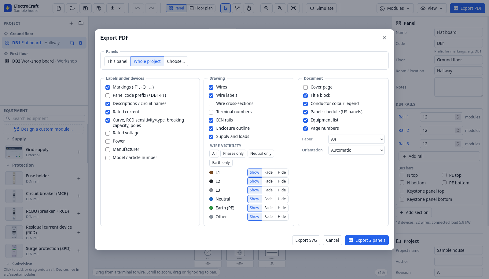

* **Panels:** this panel, the whole project, or a hand-picked selection.
* **Labels under devices:** which of the items above are printed. They start from your View settings.
* **Drawing:** wires, wire labels and cross-sections, terminal numbers, rails, enclosure outline, supply and loads.
* **Document:** cover page, title block (project, panel, floor / room, author, revision, date), conductor colour
  legend, equipment list, page numbers, paper size (A4 / A3) and orientation (automatic picks the one that lets the
  diagram be larger).
* **Export SVG** saves the first selected panel as a single scalable drawing instead.

The PDF is vector, so it stays sharp when zoomed or printed. Fonts are embedded and cover European characters.

## Saving and opening

* **Save** (`Ctrl+S`) writes a `.ec` file (see [project-file-format.md](project-file-format.md)). **Save as**
  (`Ctrl+Shift+S`) picks a new name.
* **Open** (`Ctrl+O`). In Chrome and Edge, Save overwrites the file you opened; in other browsers it downloads a new copy.
* Your work is also **autosaved in the browser**, so a reload does not lose it. This is only a safety net: use Save to
  keep a real file.
* The toolbar's download button opens one of the **example projects** that ship with the app (the apartment is what you see on
  a first start; on a phone it is *Example projects...* in the menu). `?example=<name>` in the address opens one directly. The example
  files are in [src/assets/examples](../src/assets/examples): put a `.ec` file there and it is an example too.

## Keyboard and mouse

| | |
| --- | --- |
| Zoom | mouse wheel (at the cursor), toolbar buttons |
| Pan | drag empty canvas, **drag with the right mouse button**, middle mouse, or hold `Space` and drag |
| Fit panel to window | `F` |
| Tools | `V` select, `W` wire tool, `H` pan |
| Undo / redo | `Ctrl+Z`, `Ctrl+Shift+Z` or `Ctrl+Y` |
| Duplicate / delete | `Ctrl+D`, `Delete` |
| Nudge selected device | arrow keys (left / right: half module) |
| Cancel | `Esc` |
| Save / open | `Ctrl+S`, `Ctrl+O` (macOS: `Cmd`) |

## Phones and tablets

The app picks its layout from the browser's user agent: **phones get the touch layout**, everything else the desktop
layout (tablets included; the canvas supports touch there too). A window narrower than 700 px also gets the phone
layout. Override it with **View > Layout** (Auto, Desktop, Mobile), the *Use desktop layout* entry of the phone menu, or
`?layout=mobile` / `?layout=desktop` in the address.

In the phone layout:

* the bottom bar opens **Panels**, **Add** (equipment), **Edit** (properties of the selection) and **PDF**; the ☰ menu has
  files, view options, modules and the layout switch,
* **pinch** to zoom, **drag** the background to pan, **tap** to select, **double-tap** a wire to add a bend,
* to wire: **tap a terminal, then tap the target terminal** (use the wire tool for bends); terminals and handles are
  larger on touch screens,
* a bar above the bottom navigation shows the selection with **Edit**, **Duplicate** and **Delete**.

## Custom modules

**Modules > Design a new module...** opens the designer (full screen on a phone, with *Module* and *Design* tabs).

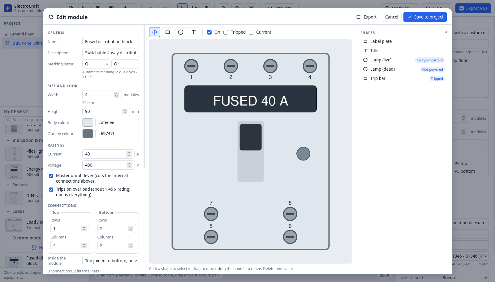

* **General:** name, description and the marking letter used for automatic markings (an `X` gives `-X1`, `-X2`).
* **Size and look:** width in modules (steps of half a module), height, body and outline colour.
* **Ratings:** current and voltage (they become editable parameters of every placed copy). Tick **Has an on/off switch**
  for a lever (open modules do not conduct) and **Trips on overload** for breaker or fuse behaviour.
* **Connections:** rows (0-3) and columns (0-24) for the **top** and the **bottom** separately, so a module can have, say,
  four terminals on top and two rows of two below. Each connection has an editable **marking**; *Renumber* numbers them
  from the top row.
* **Switches:** a module can have any number of internal **switches** (*Add switch*). Each switch has a name and a
  **changeover contact** made of two lists of terminals, which you tick from the module's connections:
  the **NO contact** (normally open) joins its terminals while the switch is **actuated**, the **NC contact** (normally
  closed) joins its terminals while the switch is **released**. Fill only one list for a plain NO or NC contact (the badge
  shows **NO**, **NC**, or **CO** when both are used). Put the same terminal in both lists to get a **common terminal**:
  actuating then switches it from the NC terminal to the NO terminal. Lists can hold more than two terminals, like a
  multi-pole contact, and every switch is independent. A switch is drawn as a small widget on the module face; drag it, or
  type x and y. **Untick "Show the switch on the module face"** to hide the widget: a hidden switch still works, and its state
  can drive other shapes (below), which is how you imitate indicator lights. The *master on/off lever* option is separate: it
  cuts the always-on connections chosen under *Inside the module*.
* **Inputs:** an input is a terminal that **operates switches when it is energised**, like the coil of a relay or contactor.
  *Add input* (needs at least one switch) and choose the **input terminal**, an optional **return terminal** (the other coil
  terminal) and the **switches it operates**. An input is energised when its terminal carries a live phase; with a return
  terminal it also needs the neutral (or another phase) there, so a coil only pulls in when it is wired both ways. The mode
  decides what energising does:
  * **Follow the input:** the switch is actuated for as long as the input is energised (a relay or contactor),
  * **Toggle on each rising edge:** every time the input becomes energised the switch changes position and stays there (an
    impulse relay or latching contactor),
  * **Set** / **Reset:** becoming energised actuates / releases the switch and it stays (the two coils of a latching relay).

  An input can drive several switches and a switch can be driven by several inputs. Input terminals are ringed in blue on the
  canvas. Shapes can follow an input (*energised* / *not energised*), so a lit lamp on the module can show the coil. The
  *In ...* boxes above the canvas preview an energised input (the preview does not remember earlier pulses).
* **Inside the module:** *Top joined to bottom, per column*, *All terminals joined* (a bar), *Nothing joined*, or *Custom
  nets*, where terminals with the same net name are joined. The simulation follows these connections.
* **Design:** draw with the **rectangle**, **circle** and **text** tools, drag to move, use the handle to resize, and set
  colours, outline, opacity and the corner radius in the shape panel. Shapes can be reordered. Text may use tokens such as
  `{{In}}`, `{{Un}}` and `{{marking}}`. Each shape can be shown **always**, with the master lever **on** or **off**, when
  **tripped**, when **carrying current** or **not powered**, or by the state of one of the module's switches (*actuated*,
  *released*, *contact closed*, *contact open*): these are the animation layers. The *On / Tripped / Current* boxes and one
  box per switch above the canvas preview them.
* **Indicator lights:** below *Visible when*, **Change colour when** turns a shape into a light. It takes the same
  conditions (switch on or off, tripped, carrying current, a switch actuated or a contact closed, an input energised ...);
  while the condition holds, the shape is drawn with the **Active fill** (the **Active colour** for text) instead of its normal
  fill. So a circle that is grey normally and green with *Input COIL: energised* is a coil lamp. Only the fill changes; use
  *Visible when* as well if the shape should appear or disappear.

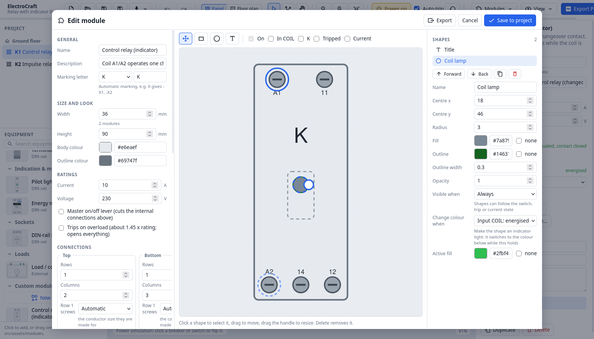

On a placed module, the properties panel lists every switch (including hidden ones) with a checkbox (actuated or released)
and shows whether a contact is closed. Every input has a drop-down for how **this device** reacts (follow, toggle, set,
reset); the module's own mode is marked *(default)*. Pick another one to override it for this copy only, and pick the default
again to clear the override, so two relays made from the same module can behave differently. **Clone as new module...**
under *Custom module* makes a copy of the module and opens it in the designer.

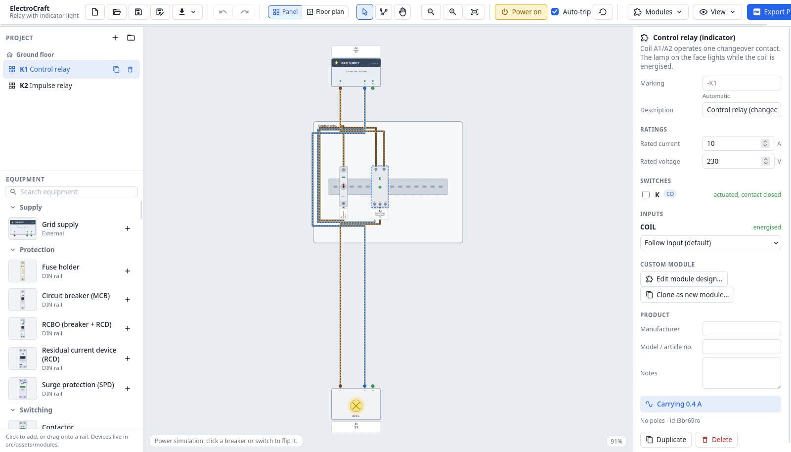
 In simulation mode you can also **click a visible switch widget on the module** to flip
just that switch;
clicking elsewhere on a module with a master lever flips the lever. A tripped module opens all of its contacts.

**Save to project** stores the module inside the `.ec` file and adds it to the **Custom modules** group of the palette,
where the pencil edits it, the clone button copies it as the base of a variation (the copy is named *X copy*, *X copy 2* ...
and opens in the designer) and the bin deletes it (devices that use it are removed too). Changing a saved module updates
every placed copy; wires to connections that no longer exist are dropped.

The app also ships a **Module library**: ready-made modules (a fused distribution block, a pushbutton contact block, a
changeover selector, a control relay, an impulse relay) in their own palette group. They are read-only; the copy button
(or *Copy to project to edit...* on a placed one) turns one into a normal, editable project module.

**Export modules...** writes a `.ecm` file; **Import modules...** accepts a `.ecm` file or a whole `.ec` project and lets
you choose which modules to add (ids and names are made unique). There is an example in
[examples/fused-distribution-block.ecm](examples/fused-distribution-block.ecm), a pushbutton block with NO and NC contacts in
[examples/pushbutton-contact-block.ecm](examples/pushbutton-contact-block.ecm), and a hidden changeover switch that drives two
indicator lamps in [examples/changeover-selector.ecm](examples/changeover-selector.ecm), and a control relay and an impulse relay
in [examples/relay-modules.ecm](examples/relay-modules.ecm), wired up in [examples/relay-circuits.ec](../src/assets/examples/relay-circuits.ec).
[examples/relay-indicator.ec](../src/assets/examples/relay-indicator.ec) has a relay whose lamp changes colour while its coil is energised.

## Designing a device

A **device** is a module with everything the built-in devices have: pole configurations that change its width and
terminals, parameters, a simulation role, a mounting kind and SVG artwork. All built-in devices are devices of this kind.
**Modules > Design a new device...** opens the device designer on a copy of the MCB; **Copy to project to edit...** (in the
properties of any placed device, and on library entries) starts from that device instead. Saved devices appear under
*Custom modules* like other project modules, and can be exported to `.ecm`.

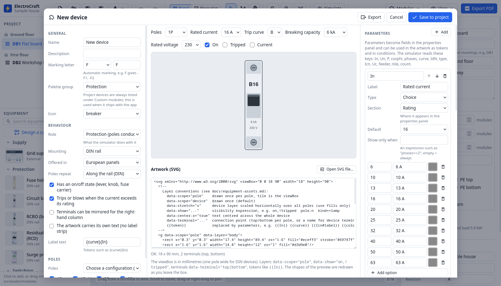

* **General:** name, description, marking letter, palette group (used when the device ships with the app) and icon.
* **Behaviour:** the **role** tells the simulator what the device is (protection, switch, meter, terminal block, bus bar,
  indicator lamp, load, supply, US breaker, US main) and so which terminals it expects; **mounting** is DIN rail, free
  (like a supply or load) or US breaker space; *Offered in* picks European or US panels; *Poles repeat* sets whether pole
  tiles go along the rail or down a column. Tick *has an on/off state* for a lever or knob, *trips* for breaker or fuse
  behaviour, and the label text (tokens such as `{curve}{In}`) is what the label strip shows.
* **Poles:** *Fixed layout*, *Choose a configuration* (tick which of 1P, 1P+N, 2P, 3P, 3P+N, 4P are offered) or a *Free
  number of terminals* with a minimum, maximum and default (bus bars and terminal blocks).
* **Parameters:** each becomes a field in the properties panel. Choose its key, label, type (choice, number, text, yes/no),
  section (configuration or rating), default, an optional *show only when* condition such as `phases>=2`, and for choices
  the options (value, label and an optional colour for `{{param#hex}}` tokens). The simulator reads a fixed set of keys:
  `In`, `Un`, `P`, `cosphi`, `phases`, `curve`, `IdN`, `type`, `Icn`, `Uc`, `feeder`, `role` and `count`.
* **Artwork:** the SVG source, with a live preview above it. The preview has controls for the poles, the first choice
  parameters and the *On / Tripped / Current* states, so you can check every layer. Terminals are circles with
  `data-terminal`; the conventions (layers per pole, `data-show` conditions, tokens, animation) are in
  [equipment-assets.md](equipment-assets.md). **Open SVG file...** loads artwork drawn in an SVG editor. The artwork may
  only contain drawing elements: scripts, links and event handlers are removed.

On a phone the designer has *Device*, *Artwork* and *Parameters* tabs.

## US load centers

Add one with the **+** next to *Project* > **Load center (US)**. A project can mix DIN-rail and US panels; the palette
shows the equipment that belongs to the open panel.

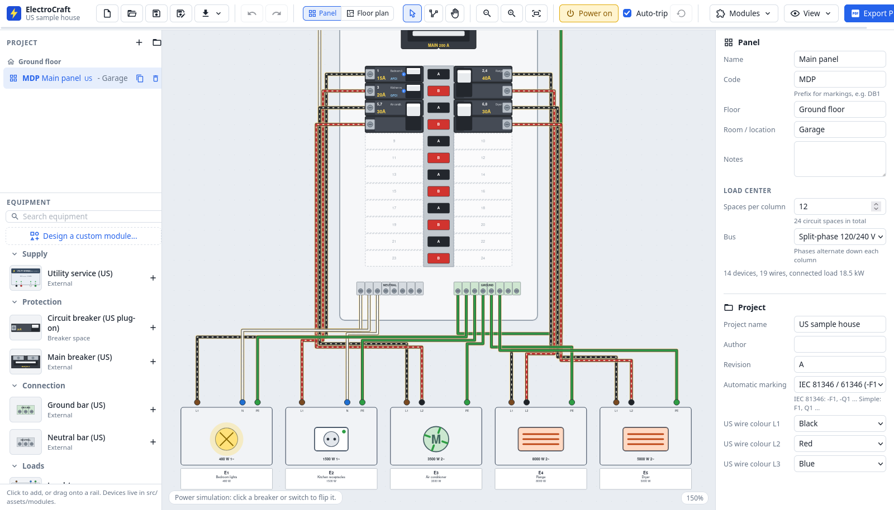

* **Layout:** two columns of breaker spaces either side of the bus, numbered the NEC way (left column odd, right column
  even, counting down). Bus phases alternate down the panel (A, B, A, B...), so a 2-pole breaker takes two spaces of one
  column and gets both legs. Set the spaces per column and the bus (split-phase or three-phase) in the panel properties.
* **Breakers:** plug-on 1-, 2- and 3-pole breakers with ratings from 15 to 100 A and the types Standard, AFCI, GFCI and
  AFCI/GFCI. They sit in the spaces (drag between spaces and columns), take their line side from the bus automatically,
  and you wire only the **load terminal**, which faces out of the panel.
* **Main breaker** (2 or 3 pole): wire the **utility service** to its top lugs; it feeds the bus.
* **Neutral and ground bars:** wire neutrals and equipment grounds to their terminals.
* **Utility service:** split-phase 120/240 V or three-phase 208Y/120 V, 100 to 400 A.
* **Loads:** 1 phase (120 V), **2 phase** (240 V line-to-line, e.g. ranges, dryers, air conditioners) or 3 phase (208 V).
  The load's voltage is automatic per panel type; type a voltage to override it.
* **Wires:** black (A), red (B), blue (C), white (neutral), green (ground); wire size in **AWG**. The colours of the phases
  can be changed in the project properties.
* **Markings:** breakers show their space numbers (`1`, `2,4`), the main shows `MAIN`, the bars `N` and `G`.
* **PDF:** a **panel schedule** page lists circuit, poles, breaker, description, wire gauge and the simulated load as a
  percentage of the breaker rating. Try [examples/us-sample-house.ec](../src/assets/examples/us-sample-house.ec).

## URL options

Append these to the address to share or reproduce a view:
`#sim` (simulation on), `#panel=2`, `#z=2&x=-300&y=-100` (zoom and pan), `#select=item:3` (or `wire:N`, `rail:N`),
`#export` (open the export dialog), `#floor` (the floor plan workspace), `?layout=mobile|desktop`. The hash options can be combined with `&`.

## Troubleshooting

| Problem | Cause / fix |
| --- | --- |
| A circuit does not show up in the panel | The cable has to end at the panel: finish the circuit by clicking the panel marker (or choose the panel in the circuit's properties). |
| "No free space on the DIN rails" | Lengthen a rail, add a rail, or remove something. |
| Changing the poles of a device is refused | Not enough free modules to its right. Move neighbours or lengthen the rail. |
| Some wires disappeared after reducing poles | Wires to terminals that no longer exist are removed (you get a message). `Ctrl+Z` undoes it. |
| A pilot light does not light | Its top terminal must be on exactly one live phase and its bottom terminal on neutral, and the circuit must be energised. |
| A load shows "Not powered" | It needs both a live phase (`L1`) and neutral (`N`) connected through closed devices. A 3-phase load needs three different phases. |
| PDF text looks different from the screen | Intended: PDF text uses the embedded Liberation Sans font. |
