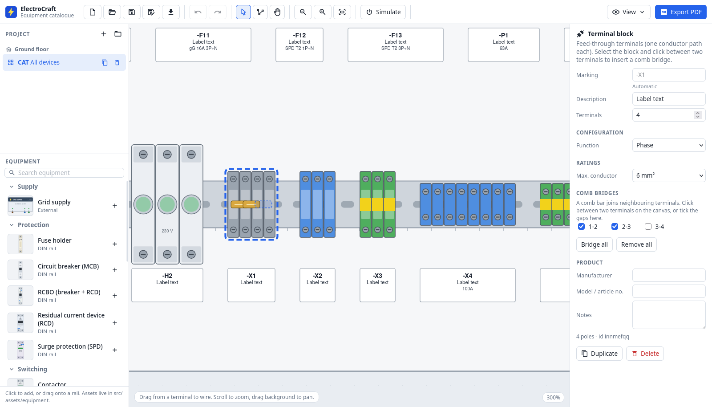
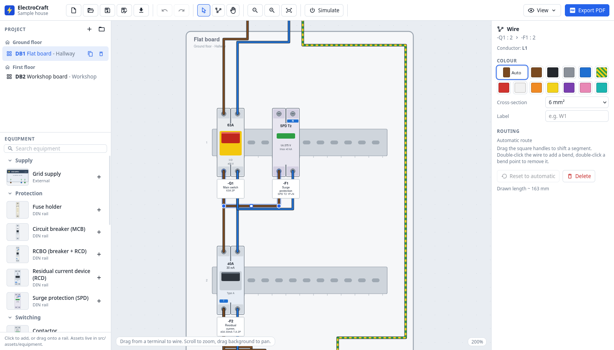
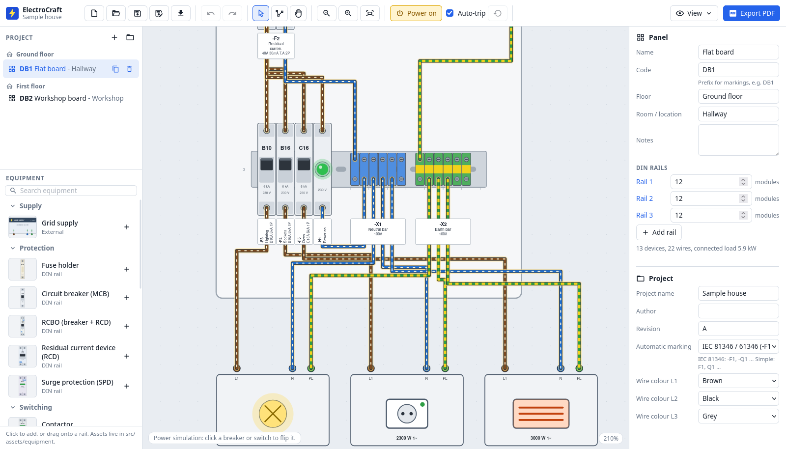
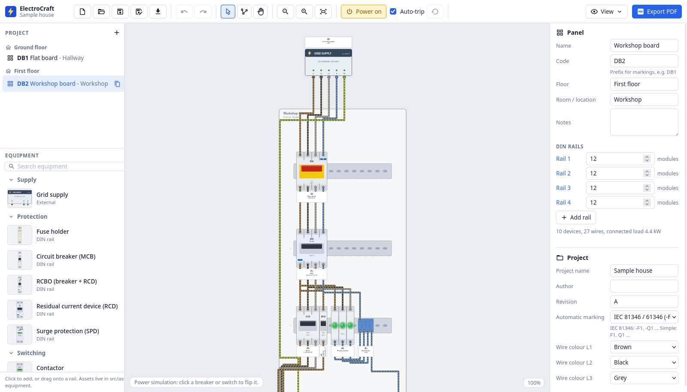
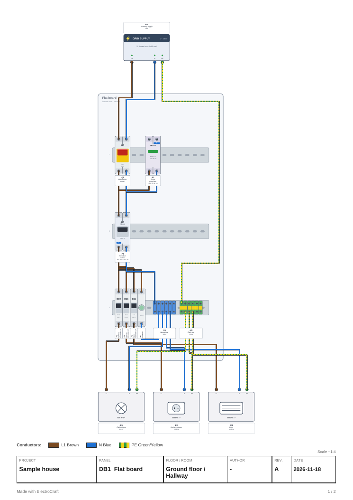

# User guide

This guide covers everything ElectroCraft can do. If you just want to try it, the
[README](../README.md) has a two-minute tour.

## The screen

| Area | What it does |
| --- | --- |
| **Top toolbar** | New / open / save, undo / redo, tools, zoom, **Simulate**, **View** options, **Export PDF** |
| **Left, top: Project** | Your floors and panels. Click a panel to open it. |
| **Left, bottom: Equipment** | Everything you can place. Search, click to add, or drag onto a rail. |
| **Centre** | The panel: enclosure, DIN rails, devices, wires |
| **Right** | Properties of whatever is selected (device, wire, rail), or of the panel and project when nothing is |

## Projects, floors and panels

A project holds any number of panels. Each panel has a **name**, a **code** (such as `DB1`, used as a marking prefix),
a **floor** and a **room**. The Project tree groups panels by floor.

* **+** next to *Project* adds a panel on the current floor; the folder button adds one on a new floor.
* Hover a panel to **duplicate** or **delete** it.
* Rename a panel, change its floor or room, or edit the DIN rails in the properties panel (click empty canvas to see it).
* **Rails:** each panel starts with two 12-module rails. Add more, change their length, or reorder them there.
  A rail cannot be shortened below the devices on it.

## Placing equipment

* **Click** an entry in the palette to place it on the first free spot (on the selected rail, if you selected one).
  Or **drag** it onto a rail.
* Devices **snap to half-module positions** and never overlap. If a rail is full you get a message instead.
* **Move** by dragging. Arrow keys nudge by half a module. Hold **Shift** to select several devices.
* **Duplicate** with `Ctrl+D`, **delete** with `Delete`.
* The supply and loads are *external* items; they can be placed anywhere outside the enclosure.

### Poles, phases and ratings

Select a device to change it in the properties panel:

* **Poles / phases**: 1P, 1P+N, 2P, 3P, 3P+N (what is offered depends on the device). A bigger device needs more room
  on the rail; if it does not fit, the change is refused. Wires to poles that no longer exist are removed.
* **Ratings** where they make sense: rated current, trip curve (B/C/D/K/Z), breaking capacity, RCD sensitivity and type,
  voltage, load power, power factor.
* **Supply:** choose 1, 2 or 3 phases and the main fuse; the matching terminals appear.
* **Loads:** lighting, heater, motor, socket circuit or generic, 1 or 3 phase, with power and power factor.
* **State:** breakers, switches, fuse holders and the supply can be on or off. Off devices show their lever or carrier
  in the open position.
* **Product info:** manufacturer, model / article number and notes. These can appear on the label strips and in the
  equipment list of the PDF.

### Terminal blocks and comb bridges

Select a terminal block. Between each pair of neighbouring terminals a dashed slot appears: click it to insert a
**comb bridge**, click a bar to remove it. The properties panel has checkboxes per gap plus *Bridge all* /
*Remove all*. Bridged terminals are one conductor in the simulation.

## Wiring

**Drag from one terminal to another** to connect them. Terminals highlight when you hover them. Any number of wires
can share a terminal. Wiring the same two terminals twice is refused.

For wires with hand-placed bends, switch to the **wire tool** (`W`): click a terminal, click empty space for each bend
(bends snap to horizontal/vertical), then click the target terminal. `Esc` cancels.

### Colours

* **Auto** (default): the colour follows what the wire is connected to, by the IEC 60446 convention:
  L1 brown, L2 black, L3 grey, neutral blue, protective earth green/yellow. You can change the L1/L2/L3 colours for the
  whole project (properties panel with nothing selected).
* Or pick any of twelve colours for a single wire. Select the wire to do this.
* A wire that joins two different potentials is drawn red with a dashed overlay, and a short-circuit warning appears.

### Routing

Routes are automatic and orthogonal. Wires leave a terminal straight up or down, run in the channels between the
rails, and use side channels to go around the panel. Wires in the same channel are given separate lanes.

To adjust a route, **select the wire**:

* drag a **square handle** to shift a whole segment sideways,
* drag a **round handle** (bend point) to move it,
* **double-click** the wire to add a bend, **double-click** a bend point to remove it,
* **Reset to automatic** in the properties panel throws the manual route away.

Other wire properties: cross-section (shown in the PDF if you enable it) and a free-text label.

## Simulation

Press **Simulate**. Now:

* wires that carry voltage glow, and animated dashes show the **direction and size of the current**;
* **pilot lights**, lamps, heaters, motors and sockets show when they are powered;
* click a **breaker, switch, fuse holder or the supply** to flip it, and watch the rest of the panel react;
* breakers and fuses **trip on overload** (about 1.45 x In, fuses 1.6 x In). Re-arm a device from its properties,
  or all at once with the reset button in the toolbar. Untick **Auto-trip** to see overloads without tripping;
* **warnings** appear at the top left of the canvas: short circuits, overloads, tripped devices. Click one to select
  the device or wire.

The simulation handles 1, 2 and 3 phase supplies; a 3-phase motor draws balanced current on all three phases.

See [simulation.md](simulation.md) for what is and is not modelled.

## Markings

Each device has a **marking**, the label that appears on its strip and in the equipment list.

* **Automatic** (default): reference designations from the device type, numbered in reading order (rail by rail, left to
  right): `-Q1` main switch, `-F1`, `-F2`... protection, `-K1` contactor, `-X1` terminal, `-H1` indicator, `-P1` meter,
  `-E1` load, `-G1` supply.
* **Manual**: type your own text in the *Marking* field. Devices with a manual marking are skipped when numbering, so
  the automatic ones close up around them. Click the reset arrow to go back to automatic.
* **Standard** (project setting): *IEC 81346 / 61346* (`-F1`) or *Simple* (`F1`).
* **Panel code prefix** (`+DB1-F1`) is optional and can be switched on for the PDF.

## What is shown on screen

**View** in the toolbar toggles what the label strips and drawing show: markings, descriptions, rated current,
protection data (curve, RCD data, breaking capacity, pole count), voltage, power, manufacturer, model, terminal numbers,
wire labels and cross-sections, rails, enclosure, and the supply and loads.

## Exporting

**Export PDF** opens the export dialog.

* **Panels:** this panel, the whole project, or a hand-picked selection.
* **Labels under devices:** which of the items above are printed. They start from your View settings.
* **Drawing:** wires, wire labels and cross-sections, terminal numbers, rails, enclosure outline, supply and loads.
* **Document:** cover page, title block (project, panel, floor / room, author, revision, date), conductor colour
  legend, equipment list, page numbers, paper size (A4 / A3) and orientation (automatic picks the one that lets the
  diagram be larger).
* **Export SVG** saves the first selected panel as a single scalable drawing instead.

The PDF is vector, so it stays sharp when zoomed or printed. Fonts are embedded and cover European characters.

## Saving and opening

* **Save** (`Ctrl+S`) writes a `.ec` file (see [project-file-format.md](project-file-format.md)). **Save as**
  (`Ctrl+Shift+S`) picks a new name.
* **Open** (`Ctrl+O`). In Chrome and Edge, Save overwrites the file you opened; in other browsers it downloads a new copy.
* Your work is also **autosaved in the browser**, so a reload does not lose it. This is only a safety net: use Save to
  keep a real file.
* The toolbar's download button loads the **sample project**. Example files are in [examples/](examples).

## Keyboard and mouse

| | |
| --- | --- |
| Zoom | mouse wheel (at the cursor), toolbar buttons |
| Pan | drag empty canvas, middle mouse, or hold `Space` and drag |
| Fit panel to window | `F` |
| Tools | `V` select, `W` wire tool, `H` pan |
| Undo / redo | `Ctrl+Z`, `Ctrl+Shift+Z` or `Ctrl+Y` |
| Duplicate / delete | `Ctrl+D`, `Delete` |
| Nudge selected device | arrow keys (left / right: half module) |
| Cancel | `Esc` |
| Save / open | `Ctrl+S`, `Ctrl+O` (macOS: `Cmd`) |

## URL options

Append these to the address to share or reproduce a view:
`#sim` (simulation on), `#panel=2`, `#z=2&x=-300&y=-100` (zoom and pan), `#select=item:3` (or `wire:N`, `rail:N`),
`#export` (open the export dialog). They can be combined with `&`.

## Troubleshooting

| Problem | Cause / fix |
| --- | --- |
| "No free space on the DIN rails" | Lengthen a rail, add a rail, or remove something. |
| Changing the poles of a device is refused | Not enough free modules to its right. Move neighbours or lengthen the rail. |
| Some wires disappeared after reducing poles | Wires to terminals that no longer exist are removed (you get a message). `Ctrl+Z` undoes it. |
| A pilot light does not light | Its top terminal must be on exactly one live phase and its bottom terminal on neutral, and the circuit must be energised. |
| A load shows "Not powered" | It needs both a live phase (`L1`) and neutral (`N`) connected through closed devices. A 3-phase load needs three different phases. |
| PDF text looks different from the screen | Intended: PDF text uses the embedded Liberation Sans font. |
